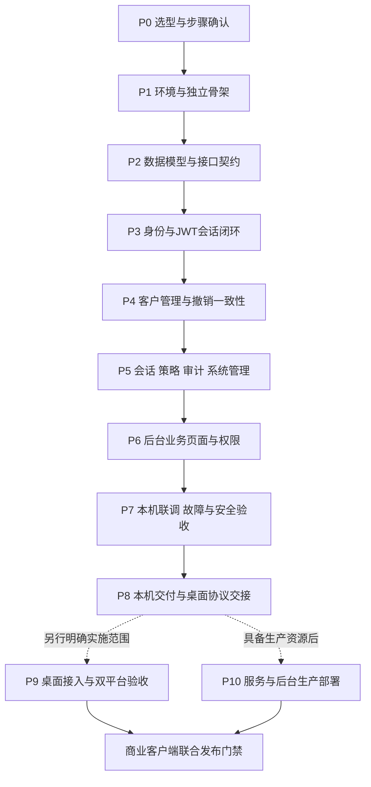

# 票小理账号服务与管理后台分阶段开发步骤流程

- 版本：1.3
- 日期：2026-11-03
- 状态：P0～P3已完成；见[P3验收记录](verification/P3-authentication.md)。P4及后续未启动。
- 依据：[PRD](PRD.md)、[开发需求说明书](DEVELOPMENT_SPEC.md)、[ADR-0001](decisions/ADR-0001-auth-and-persistence.md)
- 当前目标：在Mac上完成独立账号服务、管理后台及真实接口联调验收；不要求当前具备生产服务器。
- 当前边界：P3真实认证、会话与登录闭环已完成；仅操作本项目专用开发库，不修改同级ticket-shop、不操作真实客户数据。开发密钥已按授权创建，实际管理员由使用者在终端设置；P4等待阶段确认。

## 1. 已确认基线与实施边界

### 1.1 选型清单

| 类别 | 已确认方案 | 实施时需验证的内容 |
|---|---|---|
| 工程组织 | 同仓库backend/与frontend/，前后端分离 | 独立依赖、启动、构建、产物和发布；后台dist不打进后端JAR |
| 后端 | Java21、Spring Boot3.5系列、Spring Security | Boot精确补丁及依赖安全/兼容性，禁止自行改升大版本 |
| 持久化 | MyBatis-Plus＋Flyway | Boot3专用starter、分页插件依赖、Flyway MySQL模块的真实组合 |
| 数据库 | 复用Docker mysql:8.0 | 127.0.0.1:3306；精确补丁≥8.0.16、独立库/账号、UTC |
| 缓存 | 复用Docker redis:7-alpine | 127.0.0.1:6379；补丁、key前缀隔离、连接与命令超时 |
| 认证 | JWT＋Redis，每次认证检查MySQL权威事实 | 篡改拒绝、身份域隔离、撤销、缓存丢失及故障时不放行 |
| 后台 | Vue Pure Admin官方中文精简版＋Element Plus | 上游SHA、LICENSE、Node/pnpm和lockfile可重建 |
| 业务规则 | 桌面默认24h、校验5min、网络窗口10min | 策略1–24h；改密/冻结/停用/撤销不复活旧会话 |
| 后台规则 | 超管/运营；8h绝对、30min空闲 | 首次改密后重新登录；轮询不续空闲；超管保护 |
| 推进方式 | 每阶段验收、展示证据，用户确认后进入下一阶段 | 技术自检通过不等于已获下一阶段执行授权 |
| 外部条件 | 暂无生产服务器，容量暂未确定 | 生产与容量专项单列，不能成为本机功能开发的先决条件 |

### 1.2 环境事实与待验证项

P0观察时Docker不可达。P1经用户授权启动指定compose的mysql/redis，现已验证MySQL8.0.46、Redis7.4.10及独立库账号连接；Java21.0.12、Maven Wrapper3.9.16、Node22.23.3与显式Corepack pnpm11.25.0构建通过。具体证据以[P1记录](verification/P1-foundation.md)为准。

后续不重复安装JDK，不更改全局Java/Node默认值，不重建或升级共享MySQL/Redis，不读取敏感配置文件。凭据由用户在获准的安全配置流程中注入，文档和聊天均不要求粘贴密码。JWT签名材料只在后续实施时按明确流程提供，不在本次生成。

### 1.3 文档、代码与验收的关系

- 本文件细化开发说明书S0–S7，原S编号保留用于需求追踪；本文件P编号用于执行，B/F/I编号用于后端、前端、联调步骤。
- 执行某阶段只处理该阶段交付物；发现上游契约缺陷先修正文档与相关测试，不顺手扩展产品范围。
- P0为已完成的文档阶段；后续“继续”已授权P1，P1实测完成后停止，等待用户确认P2。
- 每个阶段都必须有真实检查结果。未完成、失败、环境阻断和不在范围内分别记录，禁止用“命令退出0”替代行为验收。

## 2. 总体顺序、依赖与前后端协作



| 阶段 | 前后端工作重点 | 对应开发说明书/PRD | 完成后允许的下一步 |
|---|---|---|---|
| P0 | 确认选型、编写本文并同步冲突文档 | S0 / A | 用户明确开始P1 |
| P1 | 后端骨架、前端模板、MySQL/Redis环境预检 | S1 / A | 环境与干净构建通过后评审P2 |
| P2 | 表结构、Mapper约定、完整OpenAPI及前端类型 | S1与S2准备 / A | 契约冻结后评审P3 |
| P3 | 管理/桌面认证服务，后台登录及首次改密 | S2 / B、C基础 | 真实身份闭环后评审P4 |
| P4 | 客户资料、期限、状态、密码与撤销服务 | S3 / B | 无页面也可验证管理闭环后评审P5 |
| P5 | 会话、概览、日志、管理员、策略服务 | S3 / B | 后端清单完整后评审P6 |
| P6 | 用户、会话、日志、管理员、策略全部真实页面 | S4 / C | 页面/API/数据库一致后评审P7 |
| P7 | 两套构建、真库、Redis故障、并发、安全、浏览器 | S4与S6本项目部分 / E部分 | 本仓库P0检查全通过后评审P8 |
| P8 | 本机可重复运行交付、桌面API交接 | S6本项目边界 | 当前主线完成；不声称桌面或生产完成 |
| P9 | 仅后续另行安排的桌面项目实现与双平台验证 | S5/S6 / D、E | 与P10共同满足商业发布门禁 |
| P10 | 后续生产资源、HTTPS、备份恢复、发布 | S7服务端部分 / F | 与P9共同形成完整发布验收 |

前端在P1初始化布局、P2准备类型、P3接入登录，P6完成业务页面。后端P4/P5开发时，前端可以按已冻结契约准备组件和表单；真实接口未完成的页面不计验收，不使用Mock登录充当完成证据。不要求创建子Agent或同时修改多个工作区。

## 3. 每阶段统一执行与证据规则

### 3.1 执行流程

1. 开始时引用阶段与步骤编号，检查上一阶段验收记录和用户确认。
2. 核对当前仓库状态，保留用户已有修改；创建本阶段所需最小文件。
3. 按B步骤实现后端、按F步骤实现前端，接口变化先更新OpenAPI及类型。
4. 完成针对性测试，再按I步骤验证真实HTTP、数据库与相关Redis状态；失败继续定位。
5. 检查敏感信息、范围与文档一致性，记录实际证据和残留问题。
6. 报告阶段结果，停止；只有用户确认才进入下一阶段。阶段内部连续完成依赖步骤，不为每个普通文件反复请求确认。

### 3.2 证据记录格式

后续在 `docs/verification/Pn-阶段名.md` 保存：构建提交/版本、执行时间、macOS/CPU、Java/Node/pnpm/MySQL/Redis实际版本、前置状态、用例编号、步骤、预期、实际、脱敏HTTP/requestId、数据库与缓存回读、测试结果、未验证项、是否满足阶段退出条件。

不保存密码、JWT原文、Cookie、私钥、数据库连接密码和真实客户数据。UI截图可用于状态证据，但不能代替持久化与撤销接口检查。测试账号全部合成；不将真实票据引入本项目。

## 4. P0：确认基线与流程文档（本次交付）

前置：用户确认MyBatis-Plus＋Flyway、JWT＋Redis、本机MySQL8/Redis7、同仓库前后端分离及其余业务规则。

| 步骤 | 动作 | 产出/验收 |
|---|---|---|
| P0-01 | 区分已确认选型、实测环境、暂未具备的外部条件 | Java21可运行与Docker不可达分别记录，不推测数据库就绪 |
| P0-02 | 同步README、PRD、开发说明书中的旧技术建议 | 不再把MySQL8.4、Spring JDBC、无Redis作为当前方案 |
| P0-03 | 编写JWT/Redis/MySQL职责决策及本文 | 明确撤销、跨存储提交失败、缓存恢复与故障语义 |
| P0-04 | 检查任务依赖、前后端拆分、验收覆盖与文档链接 | 无业务代码、无工程初始化、无ticket-shop修改 |

退出条件：本文可逐步执行且待办边界明确。停止点：交付文档，等待用户明确开始P1。

## 5. P1：本机环境与前后端独立工程骨架

前置：P0交付后用户明确开始本阶段；Docker服务须能在本机连接。Docker不可达时先记录阻断原因，不自动切换到其他daemon、不重建既有容器。

### 5.1 后端步骤

| 编号 | 具体顺序 | 完成标准 |
|---|---|---|
| B1-01 | 检查jenv登记和Java21；项目局部绑定openjdk64-21.0.12；验证Maven实际运行JDK | 新终端项目内Java21，不修改全局默认 |
| B1-02 | 只读检查MySQL/Redis容器名、镜像、端口和状态，不读取容器环境变量 | 确认3306/6379及实际补丁；不公开凭据 |
| B1-03 | 确认独立开发库ticket_shop_admin及专用账号的供给方式、Redis逻辑库和key前缀 | 不共享业务表；不改其他项目配置；缺少凭据按安全流程提供 |
| B1-04 | 在backend建立Java21/Boot3.5骨架与Maven Wrapper，锁定可用补丁 | pom与Wrapper校验和可追溯；无桌面Maven依赖 |
| B1-05 | 引入Security、Validation、MyBatis-Plus Boot3 starter、Flyway/MySQL模块、Redis、JOSE、测试依赖 | 依赖树无重复MyBatis starter；实际版本清单可复现 |
| B1-06 | 建立development/test/production配置边界、UTC和健康检查 | 不使用跳过认证开关；缺生产配置不能默认为开发配置 |
| B1-07 | 建立MySQL/Redis测试隔离及CI后端检查入口 | 测试独立容器/库，不清空开发或共享服务；无Docker时集成检查明确失败 |

### 5.2 前端步骤

| 编号 | 具体顺序 | 完成标准 |
|---|---|---|
| F1-01 | 固定官方中文精简版SHA与LICENSE，在frontend引入 | 记录来源、引入版本和删减清单，不使用非官方模板 |
| F1-02 | 核对fnm Node22与pnpm，固定项目版本和lockfile | 日常终端也能按相同版本安装，不依赖Codex临时路径 |
| F1-03 | 移除示例路由、Mock登录、模板refreshToken和默认演示管理员 | 无演示认证在生产构建生效；真实认证接入前显示未完成态 |
| F1-04 | 保留标准布局/主题，建立登录、403、404、网络错误等入口 | 中文、浅色/黑色深色、Logo不失真；无伪造业务统计 |
| F1-05 | 配置127.0.0.1:8848及/api→127.0.0.1:18080代理，建立只读lint/typecheck/build入口 | 不把URL当秘密；前端环境不出现服务端凭据 |
| F1-06 | 建立Vitest/Playwright和前端独立CI入口 | 前端构建不要求把dist复制入JAR；脚本不自动修改源文件 |

### 5.3 联调与退出条件

I1-01：在项目配置下启动后端和前端，确认前端代理命中后端，无端口冲突，无需改桌面端口。

I1-02：后端验证MySQL、Redis真实连接；健康检查区分存活/就绪，公开响应不暴露详情。未认证业务接口默认拒绝。

I1-03：从干净依赖安装分别构建前后端，记录实际版本/锁文件；MySQL必须验证CHECK支持，Redis必须能在本项目前缀写读删除测试键。

产出：backend/frontend骨架、配置键说明、版本与许可清单、[P1证据](verification/P1-foundation.md)。任一关键连接或构建失败不得计通过。当前P1已通过本机检查；远端CI未运行，正式品牌资源未导入。P2已按后续确认完成，验收见下一节。

## 6. P2：数据库、Mapper规范与完整接口契约

前置：P1通过，MySQL8.0/Redis7实测可用，独立测试资源已落实。

### 6.1 后端步骤

| 编号 | 具体顺序 | 完成标准 |
|---|---|---|
| B2-01 | 按开发说明书复核账号、管理员、会话/预认证、策略、审计、安全日志、限流、幂等、控制表 | 每张表有字段类型、中文注释、唯一约束、索引、UTC和版本约定 |
| B2-02 | 编写Flyway V1～V3迁移及必要初始控制/策略行，不创建默认管理员密码 | 空库迁移成功，重复启动不重建，校验和异常阻断 |
| B2-03 | 建立Entity/Mapper及XML位置、DTO转换、Long字符串输出、分页/排序白名单 | 不暴露Entity和password_hash；不拼接用户排序SQL |
| B2-04 | 确定expectedVersion条件更新和锁顺序，显式Mapper覆盖状态/撤销/期限/统计 | 更新行数为0映射409；不混用通用更新静默覆盖 |
| B2-05 | 编写docs/api/openapi.yaml，覆盖开发说明书8.1～8.4全部路由 | 输入、必填、错误码、Cookie/Bearer/CSRF、分页、时间、版本、幂等、一次性密码均明确 |
| B2-06 | 固定JWT claims、RS256/key引用、Redis键结构/TTL、错误分类和超时预算 | 不把JWT或Redis单独作为放行依据，PENDING提交结果可表达 |

MyBatis-Plus实现约束：普通CRUD可使用BaseMapper；复杂领域操作应有命名方法。乐观锁插件不是所有自定义SQL的自动保障；自定义更新明确携带version条件和版本递增。事务放应用服务，不放Controller；Mapper多步写入不能自行拆成多个独立事务。

### 6.2 前端步骤

| 编号 | 动作 | 完成标准 |
|---|---|---|
| F2-01 | 对照OpenAPI建立请求/响应类型、错误码、分页、UTC和ID字符串工具 | 不使用any掩盖关键字段；不把BIGINT当不安全JS number |
| F2-02 | 建立统一请求封装，启用Cookie、CSRF、requestId和错误分流 | 登录失败/403/409/429/503可分别处理，不循环刷新token |
| F2-03 | 定义管理员摘要/permissions内存状态及路由规则 | 页面不存JWT，刷新时通过/auth/me重取身份 |
| F2-04 | 统一一次性密码、冲突、确认、空列表和时间选择组件契约 | 提交密码不进入日志；按日选择使用次日零点排他上界 |

### 6.3 联调与退出条件

I2-01：OpenAPI通过格式/引用/示例校验，前后端逐条核对身份、日期、状态、版本、错误码和幂等语义。

I2-02：真实MySQL运行唯一性、版本冲突、期限边界和约束拒绝检查；核对表/字段注释、索引及外键。

I2-03：验证新库全量迁移、上一迁移版本升级、重复启动无变化。验证测试只能写本项目测试库与Redis前缀。

产出：可验证OpenAPI、迁移、Mapper约定、前端协议层、P2证据。退出条件：开发说明书接口清单均可在OpenAPI定位，数据库约束真实生效。当前本机P2验收通过，见[P2记录](verification/P2-data-and-contract.md)；远端CI未运行。P3已按后续确认完成，见下一节。

## 7. P3：身份认证、JWT会话与后台登录闭环

前置：P2契约稳定，使用合成管理员/客户账号，具备后续开发专用签名配置。

### 7.1 后端步骤

| 编号 | 具体顺序 | 完成标准 |
|---|---|---|
| B3-01 | 实现标准密码编码、输入校验和未知账号虚拟摘要 | 12–128码点不截断，密码验证前统一错误，无明文落库 |
| B3-02 | 实现离线一次性超管引导、控制行锁与初始化审计 | 无公开引导接口/默认密码；并发引导最多一个成功 |
| B3-03 | 实现JWT签发/验证、admin/client分离过滤链及身份类型/用途约束 | 错签名、错alg/audience、缺claims、越身份域均拒绝 |
| B3-04 | 实现MySQL会话、Redis会话摘要、每次数据库权威检查 | 缓存缺失按有效DB记录重建；缓存过旧不能放行；Redis/DB故障503 |
| B3-05 | 实现客户login/first-password/validate/account/password/logout | 首次凭据最多10min；改密撤销旧会话；正常24h不滑动 |
| B3-06 | 实现管理员csrf/login/first-password/me/activity/password/logout | JWT在HttpOnly Cookie；CSRF/Origin；8h/30min及轮询不续空闲 |
| B3-07 | 实现账号/来源限流与登录安全记录，Redis辅助、DB计数持久化 | 并发阈值不穿透；成功只清账号失败累计；重启不清零 |
| B3-08 | 实现认证错误、no-store、敏感字段脱敏、可注入测试时钟 | 网络故障与账号拒绝区分，服务日志不记录请求正文/完整token |

认证成功必须在数据库提交后返回；Redis会话创建失败不得发放可用登录结果。若DB已产生但响应未返回的孤立会话，保持原上界、可由管理端撤销，不回滚其他已提交状态。身份确认后的拒绝返回可理解的全部适用原因。

### 7.2 前端步骤

| 编号 | 具体顺序 | 完成标准 |
|---|---|---|
| F3-01 | 接真实CSRF/登录，完成账号密码、显示隐藏、提交禁重与错误提示 | 不存在账号/错密码统一文案，失败保留账号不持久化密码 |
| F3-02 | 实现首次改密专页、提交后重新登录，不允许进入其他路由 | 改密凭据不可调用概览/用户列表；错误不清空必要输入 |
| F3-03 | 接/auth/me恢复管理员摘要和permissions；完成登录守卫/退出 | 刷新后服务端重新确认身份；退出清理内存和Cookie状态 |
| F3-04 | 实现真实活动上报和认证失效单一入口 | 后台轮询不发activity，失效不叠弹窗或无限重试 |

### 7.3 联调与退出条件

I3-01：离线引导→真实后台登录→本人改密→旧会话失效→重新登录→退出，核对数据库、Cookie属性和Redis键。

I3-02：通过HTTP完成客户临时密码→受限JWT→首次改密→新密码登录→校验→重启→原期限校验→退出。此时客户创建可以由后端测试夹具生成，不开放未设计的生产测试接口。

I3-03：控制时钟覆盖24h、8h、30min、10min首次改密；错密码、限流、CSRF、错身份域、篡改token与服务故障均有证据。

产出：认证服务、后台登录页、API契约实现及P3证据。DEV-02/03/04/12/13/14/15相关认证项通过；本机证据见[P3记录](verification/P3-authentication.md)，远端CI未运行。停止点：确认P4。

## 8. P4：客户账号、状态、期限与密码管理服务

前置：P3通过，正常管理员可认证，审计事务能力已有基础。

### 8.1 后端步骤

| 编号 | 具体顺序 | 完成标准 |
|---|---|---|
| B4-01 | 实现/users分页筛选、白名单排序、详情、账号/期限双状态 | 10/20/50/100分页，全结果排序，详情展示全部阻碍 |
| B4-02 | 实现创建账号与基本资料PATCH，唯一规范键和字段白名单 | 创建必须有效起止；显示名/备注编辑不覆盖不可见字段 |
| B4-03 | 实现冻结/解冻/停用/启用状态机 | 冻结停用撤销全部会话；解冻启用不延期、不复活旧JWT |
| B4-04 | 实现改期、期限缩短确认所需前后值、过期即时判断 | validFrom≤now<validUntil；缩短撤销；延期不延长会话 |
| B4-05 | 实现临时密码一次性交付、重置密码与强制改密 | 密码仅成功响应一次可见；改密/重置撤销所有旧登录 |
| B4-06 | 实现expectedVersion、Idempotency-Key、状态/会话/审计同事务 | 冲突409；重试不重复副作用；密码不缓存和重放 |
| B4-07 | 实现提交后缓存同步与PENDING结果，读时纠正缓存 | DB已提交不能假报回滚；旧缓存不绕过DB资格检查 |
| B4-08 | 验证锁顺序和事务失败路径 | 登录与冻结并发无可用漏网会话；审计失败回滚业务 |

### 8.2 前端准备

F4-01：按P2契约准备用户表格、详情抽屉、创建表单、基本资料表单和操作确认组件；状态/期限双标签、时间区间和版本字段必须可表达。

F4-02：准备单次密码结果弹窗与复制交互、结果未确认/409/PENDING提示；本阶段不以未接通的页面计验收，完整操作接入安排在P6。

### 8.3 联调与退出条件

I4-01：直接HTTP完成创建→首次改密→正常登录→冻结→旧JWT拒绝→解冻→旧JWT仍拒绝→重新登录→改期→停用/启用→重置密码。

I4-02：两管理员同version改期，只允许一次成功；重复Idempotency-Key不新增业务/审计，异内容复用409；响应丢失后不能取回旧临时密码。

I4-03：合成并发冻结/登录与校验至少100轮；注入审计写失败、DB故障、提交后Redis写失败。回读DB和Redis验证真实状态，不用HTTP200独立判定。

产出：客户管理API、Mapper事务测试、前端组件准备、P4证据。DEV-01/05/06/08/09/10相关项通过。停止点：确认P5。

## 9. P5：会话、概览、审计、管理员与策略服务

前置：P4通过，客户管理与撤销路径可独立验证。

### 9.1 后端步骤

| 编号 | 具体顺序 | 完成标准 |
|---|---|---|
| B5-01 | 实现客户会话分页、有效/过期/撤销筛选、近期在线独立标记 | 最近10min成功校验≠正在操作；无token/摘要暴露 |
| B5-02 | 实现单会话/账号全部撤销 | 明确目标账号版本，提交后旧JWT拒绝，账号状态不变 |
| B5-03 | 实现概览真实统计和到期/异常摘要 | 统计口径可解释、含时刻、重叠卡片不相加充当总数 |
| B5-04 | 实现操作审计、客户/管理员登录日志权限过滤和分页 | 运营不能读管理员来源/策略审计，无删除/编辑API |
| B5-05 | 实现临时限流列表/解除，按realm限制权限 | 解限流不解冻；写入审计，Redis和DB状态可解释 |
| B5-06 | 实现管理员列表/创建运营/编辑/启停/重置 | 仅超管，不能提升角色，最后有效超管不可停用 |
| B5-07 | 实现策略查询/1–24h修改及版本控制 | 5/10min只读；缩短截短旧会话，放宽只对新登录有效 |
| B5-08 | 实现项目范围的过期数据清理与健康/告警指标 | 90/365天规则、会话/幂等清理；无全Redis清空命令 |

### 9.2 前端准备

F5-01：准备概览、会话、日志、管理员和策略的路由、API类型、表格与筛选组件；菜单权限使用服务端permissions。

F5-02：统一确认文案，展示“服务器已撤销”和“设备最后校验”，不展示“冻结已送达”；策略修改展示旧值、新值及影响会话数。

### 9.3 联调与退出条件

I5-01：运营/超管分别直调所有接口；运营绕过菜单访问管理员、策略及其日志必须403，桌面token调用管理链必须拒绝。

I5-02：策略24→1→24，核对旧会话expiresAt、原JWT、Redis TTL及新登录；不能把旧上界改回24h。校验固定时刻边界。

I5-03：验证概览、筛选、排序、总数与合成数据库一致；验证最后超管保护、单/全部撤销、解除限流与日志可见范围。

产出：后端全部管理接口、前端页面准备、P5证据。开发说明书8.1～8.4无缺失路由，DEV-07/11/12/17相关项通过。停止点：确认P6。

## 10. P6：后台完整业务页面与真实权限接入

前置：P5通过；P4/P5组件可复用，全部业务API已可真实调用。

### 10.1 前端步骤

| 编号 | 具体顺序 | 完成标准 |
|---|---|---|
| F6-01 | 接入概览和筛选跳转 | 无演示数据，统计时刻与口径清楚，跳转条件正确 |
| F6-02 | 接入用户列表、查询、筛选、服务端排序与分页 | 筛选回第一页，条件可清除，空/加载/网络错误分别展示 |
| F6-03 | 接入创建、详情抽屉、显示名/备注编辑、密码结果 | 正确账号唯一性反馈，提交禁重，一次性密码不落持久存储 |
| F6-04 | 接入冻结/解冻/停用/启用/改期/重置密码 | 原因与高影响二次确认；展示状态+期限及剩余阻碍 |
| F6-05 | 接入会话列表、用户详情会话、单/全部撤销 | 与账号版本关联；显示服务端结果，不假称设备已接收 |
| F6-06 | 接入操作/安全日志、筛选、详情、临时限流和解除 | 按权限展示，不出现删除入口，不回显敏感凭据 |
| F6-07 | 接入超管管理员和策略页面 | 非超管无入口，直接URL也受保护，服务端继续鉴权 |
| F6-08 | 统一409、429、401/403、503、结果未确认与PENDING交互 | 保留输入、适时刷新，超时核实结果，不盲目重复写入 |
| F6-09 | 完成浅色/深色、中文、时区、键盘操作和统一页面状态 | Logo保留原色、状态文字+颜色、确认/取消可用 |
| F6-10 | 添加关键交互单元测试与真实后端Playwright用例 | 重点覆盖提交失败、版本冲突、权限、一次性密码和退出 |

### 10.2 后端配合步骤

B6-01：根据真实页面检查缺失字段/错误语义；确需改契约先更新OpenAPI和前端类型，不能给后台增加绕过认证的专用接口。

B6-02：复核浏览器认证链、CSRF、Cookie属性、no-store及分页性能；页面看不到按钮不计后端权限验收。

### 10.3 联调与退出条件

I6-01：每个写操作按“页面输入→HTTP请求→数据库/审计提交→Redis状态→列表/详情/统计回读”验收。浏览器刷新、后端重启后状态仍一致。

I6-02：分别制造输入错误、重复点击、接口超时、409、503及缓存同步PENDING。操作结果不明确时先核实，同一幂等键不重放密码。

I6-03：超管/运营真实浏览器完成各自工作流；检验未授权URL、篡改请求、无CSRF和备注脚本输入。默认/深色及Chrome、Edge完成基本验证，Safari基础检查。

产出：完整后台、组件/浏览器测试、P6证据。DEV-15/17/18/19页面相关项通过；无未接真实接口的菜单项。停止点：确认P7。

## 11. P7：本机全链路、故障与安全验收

前置：P6通过。所有故障注入只作用于隔离测试资源或本项目客户端连接；禁止为测试停止共享MySQL/Redis容器。

### 11.1 后端与存储检查

| 编号 | 操作 | 通过条件 |
|---|---|---|
| B7-01 | 运行全部Java单元、MySQL/Redis集成、HTTP契约与OpenAPI校验 | 真实存储测试不静默跳过，失败可定位到用例和requestId |
| B7-02 | 篡改JWT、替换audience/purpose、过期/缺claims、旧密钥场景 | 不能只验签就放行，管理员/桌面身份不互通 |
| B7-03 | Redis断开/命令超时、键驱逐、旧值恢复、DB不可用 | 故障503；有效会话才可重建；已撤销JWT永久拒绝 |
| B7-04 | 冻结/登录并发、双管理员改期、改密/撤销并发 | 无提交后漏网会话，无静默覆盖，无重复审计 |
| B7-05 | 策略缩短再放宽、截止边界、重启、TTL与后台空闲 | 不延长任何旧上界，轮询不续空闲 |
| B7-06 | MySQL成功/Redis失败、审计失败、写请求超时后幂等重试 | 成功提交可回读；审计失败回滚；PENDING不假报未生效 |
| B7-07 | 隔离备份恢复演练、旧Redis快照、维护模式 | 先阻断认证、撤销旧会话、核对账号再恢复；旧JWT拒绝 |

### 11.2 前端与浏览器检查

F7-01：运行冻结lockfile安装、typecheck、只读lint、单元测试、生产构建、真实后端E2E；记录Chrome/Edge实际版本，发布前再补当时当前/上一主要版，Safari完成基础验证。

F7-02：检查localStorage/sessionStorage/IndexedDB、网络缓存、控制台和前后端日志。无JWT、临时密码、密钥或票据数据进入不允许位置；Cookie的HttpOnly/SameSite/Secure按环境正确。

F7-03：重复完整客户生命周期及运营越权失败流程；断网/服务故障、409、刷新、退出和管理员空闲失效后无状态错乱。

### 11.3 联调、范围与退出条件

I7-01：逐条执行开发说明书DEV-01～20；同时执行下文第15节JWT/Redis补充用例。记录通过/失败，不以总测试数代替核心用例证据。

I7-02：在合成账号下完成后台开户→HTTP桌面模拟器首次改密→登录→校验→后台冻结→接口拒绝→解冻后旧JWT仍拒绝→重登。模拟器只证明服务协议，不证明真实桌面入口门禁。

I7-03：实际客户规模未确定，本阶段只记录本机测试样本、耗时与资源，不承诺万人容量或生产SLA。专项容量方案留到规模确认后，不阻断已定义功能验收。

退出条件：本仓库范围全部P0通过，无认证绕过/撤销失效/敏感信息泄露/状态审计不一致；Windows桌面、真实客户端任务门禁和生产HTTPS等标记“后续独立验证”。停止点：确认P8。

## 12. P8：本机可重复运行交付与桌面协议交接

前置：P7全部本项目P0通过。

| 编号 | 交付步骤 | 完成标准 |
|---|---|---|
| B8-01 | 交付独立后端JAR、版本清单、迁移、配置键和启动/停止说明 | 项目局部Java21可运行，不附带默认密码和生产凭据 |
| F8-01 | 交付独立后台dist、版本清单及本机预览/代理说明 | 无后端密钥、无Mock、无必须嵌入JAR的依赖 |
| I8-01 | 编写本机运行、初始化、备份恢复、Redis重建和常见故障手册 | 新终端可按文档运行，无需修改全局默认环境 |
| I8-02 | 从停止的应用状态重新启动前后端，读取已有合成状态并完成登录 | 状态、撤销和期限保留，运行结果不依赖测试进程内缓存 |
| I8-03 | 交付OpenAPI、状态/错误、JWT用途/存储、5/10分钟规则及合成联调样例 | 样例无真实凭据；桌面Java侧消费者可据此实现 |
| I8-04 | 交付验收汇总、已知限制、后续桌面/生产门禁 | 明确“本机服务与后台完成”，不宣称商业版完整发布 |

桌面交接清单必须包含：服务地址受控配置、凭据由Java持有、系统安全存储/进程内回退、启动/唤醒在线确认、运行期单调时钟、明确拒绝与网络故障区分、重登上下文恢复、受限只读/备份、所有本地任务入口及安全批次门禁、Mac/Windows分别验收。

退出条件：用户能按手册重复运行并复核本机闭环；后续事项有明确归属和前置条件。停止点：本次规划的当前主线结束。不得自动进入桌面项目或部署公网服务。

## 13. P9：后续桌面接入与双平台验收（另行安排）

准入：用户明确授权在ticket-shop实施、协议版本稳定、Mac/Windows测试环境准备完成。本文不创建桌面任务或修改其代码。

| 步骤 | 后续工作顺序 | 验收条件 |
|---|---|---|
| D9-01 | 先核对桌面项目规则/架构/当前入口，形成独立实施清单 | 不依据本仓库假定桌面代码结构，不替换既有本地鉴权 |
| D9-02 | Java远程API适配、受控地址与系统凭据存储 | WebView不见JWT；安全存储不可用只退进程内 |
| D9-03 | 登录/首次改密/账户/退出/二次验证界面 | 初次进首页，二次验证保留原上下文，离线退出结果真实 |
| D9-04 | 启动/唤醒确认、5min校验/10s时限、10min窗口、时间异常 | 拒绝立即受限，失败不续窗口，重开离线不能生产 |
| D9-05 | UI、Java、Local API、收件箱、系统拖入等入口门禁 | 受限只读/备份可用，新增生产操作无法绕过 |
| D9-06 | 长任务安全边界与恢复、升级/备份/目录迁移回归 | 不丢数据、不重复改名/导出、不恢复旧凭据 |
| D9-07 | Mac/Windows分别安装、重开、冻结、改期、到期与数据保留 | AUTH-01～25适用桌面部分逐条有实机证据 |

该阶段与服务端生产准备可以独立安排，但商业客户端联合发布必须等双方验收完成。真实发票验证仍遵守后续授权及最多10份限制，其余使用合成文件。

## 14. P10：后续生产部署与发布（资源具备后）

准入：生产服务器、域名/证书、网络隔离、运维责任人、备份位置/保留、预计规模与容量目标已明确；用户另行确认开始。当前全部属于后续条件。

| 步骤 | 后续工作顺序 | 验收条件 |
|---|---|---|
| O10-01 | 核实服务器OS/架构/资源、MySQL/Redis实际版本与维护安全状态 | 不将本机镜像标签直接当作合格生产基线，必要升级单独评估 |
| O10-02 | 确定JAR或容器运行、Nginx静态目录/API代理、独立重启与回滚 | 前后端独立发布，不影响其他服务；健康/就绪可检查 |
| O10-03 | 配置HTTPS、Cookie安全属性、来源限制、JWT密钥/轮换和数据库Redis最小权限 | 公网不可直连DB/Redis；无默认密码、开发绕过、演示接口 |
| O10-04 | 数据库迁移、一次性超管引导、生产日志与告警 | 专用迁移账号与运行账号分离，审计可追溯 |
| O10-05 | 演练每日/发布前备份及旧备份恢复 | 先维护阻断再恢复；旧会话全撤销；账号变更核对完成 |
| O10-06 | 按已确认规模压测校验峰值、策略缩短、后台查询与连接池 | 有实际资源、样本、p95与错误率；达不到则不承诺容量 |
| O10-07 | 后端→后台分别部署、自检、回滚演练、更新README/隐私说明 | API真实可用，产物版本匹配，故障恢复可复现 |
| O10-08 | 与已验收桌面版本联合检查兼容范围与AUTH-01～25 | Mac/Windows证据齐全，明确未接入旧安装包不受后台控制 |

生产账号服务/后台可以先独立上线，但不能据此宣称商业客户端接入与双平台验收完成。上线前再次检查当时组件支持与安全状态，不能把本轮补丁候选当永久锁定。

## 15. 验收覆盖与JWT/Redis专项用例

### 15.1 新增存储与认证专项

| 编号 | 测试输入/故障 | 预期 | 首次验收阶段 |
|---|---|---|---|
| JR-01 | JWT篡改、alg不允许、错issuer/audience、缺sid/jti、错误purpose | 401/403，不访问越权身份对象，不产生授权窗口 | P3 |
| JR-02 | Redis连接失败/命令超时 | 已认证业务不放行，返回503；无JWT单独降级 | P3/P7 |
| JR-03 | 删除本项目某有效会话缓存键 | 只按MySQL有效记录重建，TTL与expiresAt不延长 | P3/P7 |
| JR-04 | 在Redis写回冻结前旧有效会话项 | MySQL撤销/状态仍阻断，不能复活旧JWT | P4/P7 |
| JR-05 | MySQL提交冻结成功后Redis刷新失败 | 业务提交可回读，PENDING与告警；旧会话仍不通过认证 | P4/P7 |
| JR-06 | Redis快照恢复/清空本项目前缀后重新校验 | 不重置MySQL限流/撤销/期限，不影响其他项目前缀 | P7 |
| JR-07 | MySQL不可用而Redis/JWT仍有效 | 503，不把缓存当权威放行 | P3/P7 |
| JR-08 | 策略24→1→24，JWT原exp仍24h | 按MySQL截短期限拒绝；Redis不会恢复原期限 | P5/P7 |
| JR-09 | 浏览器刷新、退出、CSRF重取和会话轮换 | JS存储无JWT，旧Cookie/CSRF不能继续写，退出幂等 | P3/P6 |
| JR-10 | 共享Redis中存在其他项目key | 本项目清理/恢复仅操作本环境前缀，无全库清空 | P2/P7 |

### 15.2 既有专项与阶段映射

| 开发说明书用例 | 实施/验收阶段 | 说明 |
|---|---|---|
| DEV-01、DEV-05、DEV-06、DEV-08、DEV-09、DEV-10 | P4、P7 | 唯一、竞态、撤销、版本、审计、幂等 |
| DEV-02、DEV-03、DEV-04、DEV-13、DEV-14 | P3、P7 | 首次改密、期限、绝对会话、限流、后台空闲 |
| DEV-07、DEV-11、DEV-12、DEV-17 | P3/P5、P7 | 策略、权限、超管、统计分页 |
| DEV-15、DEV-18、DEV-19 | P3/P6、P7 | CSRF、浏览器失败路径、敏感信息 |
| DEV-16 | P7隔离演练、P10生产演练 | 本机恢复通过不能代替生产恢复 |
| DEV-20 | P1/P2、P7 | 环境、迁移、依赖与模板重建 |

### 15.3 PRD端到端验收边界

| PRD编号 | 当前本项目能证明什么 | 还需后续证明什么 |
|---|---|---|
| AUTH-01 | 后台开户、强制改密和正常登录接口 | 真实桌面首次进首页，P9 |
| AUTH-02、AUTH-03 | 通用错误、限流、账号状态/期限拒绝 | 桌面提示与恢复，P9 |
| AUTH-04、AUTH-05、AUTH-06 | 绝对期限和启动校验协议 | 重开在线/离线行为，P9 |
| AUTH-07、AUTH-08 | 冻结提交后服务端拒绝旧JWT | 在线5min+10s、拒绝立即受限，P9 |
| AUTH-09、AUTH-10、AUTH-11 | 期限字段、503及错误分类 | 断网窗口、睡眠、回拨和单调时间，P9 |
| AUTH-12、AUTH-13、AUTH-14 | 撤销不复活、改密、策略上界 | 桌面重新登录与UI状态，P9 |
| AUTH-15、AUTH-16 | 服务端权限、版本冲突和冻结竞态 | P7可完成本项目部分 |
| AUTH-17、AUTH-18、AUTH-19 | 仅提供契约与合成接口数据 | 任务安全边界、入口门禁、台账恢复，P9 |
| AUTH-20 | P7隔离重启/恢复演练 | P10生产恢复，P9客户端表现 |
| AUTH-21 | 本服务/后台请求、日志和存储不含敏感数据 | 桌面WebView、凭据与备份，P9 |
| AUTH-22、AUTH-23 | 服务端退出和错误协议 | 离线退出、本机只读/备份，P9 |
| AUTH-24、AUTH-25 | 发布交接中明确兼容与旧版边界 | 双平台安装升级、最终发布说明，P9/P10 |

不得把AUTH-01～25整体标为本机后台验收通过；必须分别记录服务端已验证部分与桌面/生产尚未验证部分。

## 16. 检查命令、停止条件与后续更新

### 16.1 当前可进行的只读预检

```sh
jenv versions
JENV_VERSION=openjdk64-21.0.12 jenv exec java -version
JENV_VERSION=openjdk64-21.0.12 jenv exec mvn -version
node --version
pnpm --version
docker version
docker ps --format '{{.Names}}\t{{.Image}}\t{{.Ports}}\t{{.Status}}'
```

这些命令不读取现有凭据。Docker连接失败只说明当前连接不可用，不据此断言用户没有容器；不自动切换context或修改socket。

### 16.2 初始化后必须提供的检查入口

```sh
./backend/mvnw -f backend/pom.xml verify
pnpm --dir frontend install --frozen-lockfile
pnpm --dir frontend typecheck
pnpm --dir frontend lint:check
pnpm --dir frontend test:unit
pnpm --dir frontend build
pnpm --dir frontend test:e2e
```

上述命令本次不执行；目录和脚本尚未创建。后端verify必须包含真实MySQL/Redis集成与HTTP契约；OpenAPI校验入口在P2接入CI。端到端测试要有专用后端/测试库和启动清理流程，不能直接指向生产或开发账号库。

### 16.3 必须停止而非越过的情况

- 用户尚未确认上一阶段结果；不进入下一阶段。
- Docker不可达、数据库/Redis凭据或隔离资源未落实；不重复安装、重建共享服务或读取敏感文件。
- MySQL补丁不满足约束、依赖组合无法构建、JWT/缓存一致性检查失败；修复或报告真实阻碍，不换成Mock后宣称通过。
- 测试需要停止/清理共享服务或修改ticket-shop；先改为隔离故障注入，桌面实施另行安排。
- 生产资源、容量目标和双平台环境缺失；保持后续门禁，不扩大“本机完成”的结论。

本次交付结束后，下一项可执行任务是“开始P1：本机环境与前后端独立工程骨架”。本文不等同于执行该任务。
