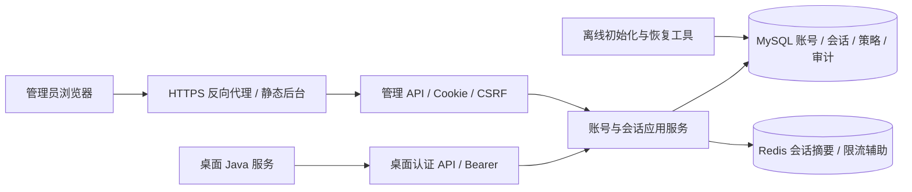

# 票小理账号授权与管理后台开发需求说明书

- 版本：1.4（P3身份认证与登录闭环已验证）
- 日期：2026-11-03
- 项目：`ticket-shop-admin`
- 依据：[README](../README.md)、[PRD](PRD.md)、[分阶段开发流程](DEVELOPMENT_PLAN.md)、[技术决策 ADR-0001](decisions/ADR-0001-auth-and-persistence.md)
- 当前状态：P0～P3已完成，见[P3记录](verification/P3-authentication.md)；业务表及13项认证HTTP操作已实现，客户管理等后续业务仍待P4及以后。
- 目标：建立可独立部署、可撤销会话、可追溯管理操作的账号服务及中文管理后台，向官方桌面客户端提供联网使用资格校验。

## 1. 文档约束与交付边界

### 1.1 需求等级

| 标记 | 含义 | 使用方式 |
|---|---|---|
| 已确认 | 用户指令或 PRD 已确认决策 | 实现必须遵守 |
| 首版基线 | PRD 建议及本文为落地提出的可评审设计 | 评审通过后作为实施基线；本次不执行安装或初始化 |
| 待确认 | 影响上线或跨项目协作的外部条件 | 在对应阶段开始前落实，不用猜测值发布 |

已确认：Java 21；Vue Pure Admin 官方精简版 + Element Plus；账号服务独立；默认登录上限 24 小时、每 5 分钟校验、网络窗口 10 分钟；先本机联调。用户已进一步确认 MyBatis-Plus＋Flyway、MySQL 8.0、JWT＋Redis 7、同仓库 backend/frontend 分离；会话与撤销事实仍持久化 MySQL。暂无生产服务器，当前以本机功能验收为目标。

### 1.2 本仓库范围

- Java 服务：客户账号、管理员、密码、使用期限、会话、校验、撤销、登录策略、限流、审计、恢复控制。
- 后台：概览、客户用户、会话、操作日志、登录安全日志、管理员和登录策略。
- 本仓库的数据库迁移、API 契约、构建、部署说明及验证证据。
- 对桌面项目交付接口协议、状态与错误约定、合成联调样例和验收用例。

不提供自助注册、支付、邮件/短信、云端票据、硬件绑定、设备配额、离线许可证、自定义 RBAC 编辑器或账号物理删除。首版使用 Redis；不引入消息队列、微服务和 OAuth 授权服务器。

### 1.3 与 ticket-shop 的协作边界

桌面项目单独管理源码、SQLite、运行时、UI、系统凭据和本地业务门禁，不进入本项目 Maven 模块。本次不读取或修改其实现，不复制其业务代码、数据库和真实票据。本文第 10 节为后续协作契约，不能视为桌面开发授权。

服务端 B、后台 C 可以独立完成；PRD 的 D/E/F 涉及桌面实现和双平台验收，必须在桌面项目另行明确安排。服务端接口测试通过不能计为客户端门禁通过。

### 1.4 文档完成标准

1. PRD 各能力有模块、数据对象、接口、权限及阶段归属。
2. 时间边界、首次改密、撤销、并发与失败语义足以直接设计实现和测试。
3. 版本候选、真实环境观察及未验证事项明确分开。
4. 发布验收可逐项记录证据；未实施项目不标记通过。

## 2. 架构与模块职责



生产桌面 API 同样经过 HTTPS 反向代理。管理后台与 API 使用同源部署；开发通过 Vite 代理管理 API，避免维护第二套跨域 Cookie 策略。

首版一个 Spring Boot 进程、一个 MySQL 业务库，按业务分包，不拆多个可部署服务。Controller 负责 DTO/协议；应用服务负责权限与事务编排；领域策略负责时间和状态判断；Repository/Mapper 使用 MyBatis-Plus 和参数化 SQL。禁止 Controller 直接更新数据库，禁止依赖浏览器传回的角色和账号状态。

| 模块 | 职责 | 核心约束 |
|---|---|---|
| customer | 账号、资料、状态、使用期限 | 账号唯一，不物理删除；版本更新 |
| authentication | 登录、首次改密、普通改密、密码编码 | 密码验证前不暴露账号状态 |
| session | 客户与管理员独立会话、撤销、资格判断 | JWT验签后检查Redis及MySQL事实，不能仅凭JWT放行 |
| administrator | 超管、运营、初始化和管理员状态 | 不停用最后一名有效超管 |
| policy | 最大会话时长及版本 | 缩短影响旧会话，放宽不延长旧会话 |
| audit | 管理审计、登录安全记录、查询 | 成功状态修改与审计同事务 |
| security | 独立过滤链、CSRF、限流、错误屏蔽 | 桌面身份无法进入管理 API |
| operations | 健康检查、清理、备份恢复和维护状态 | 恢复前阻断商业登录与校验 |
| common | 时钟、请求标识、错误、分页 | 不堆放业务规则 |

依赖方向：HTTP → 应用服务 → 领域策略/持久化端口；基础设施实现端口。跨模块通过明确服务调用，不循环调用、不跨 Controller 复用。

## 3. 技术与环境基线

### 3.1 版本与锁定策略

以下是首版候选；骨架阶段须以真实解析、许可证及安全检查结果完成锁定，不声明“当前最新”。

| 项目 | 基线 | 锁定/验证方式 |
|---|---|---|
| JDK | Java 21，由 jenv 管理 | 核对已登记 21 版本后写 `.java-version`，不改全局默认 |
| Spring Boot | 3.5.16 候选 | 固定 parent 版本；与 Java 21 启动和测试验证；上线前检查维护及安全状态 |
| Spring Security / Redis / Validation | 跟随 Boot BOM | 不各自拼接浮动版本；输出有效依赖树 |
| Maven | Wrapper 3.9.16 候选（与本机已验证版本一致） | 固定 distribution URL 与校验和 |
| 数据访问 | MyBatis-Plus（Boot 3 starter）+ 显式 Mapper SQL | 普通CRUD用Plus；锁定、条件更新、统计与审计使用明确SQL；版本在S1锁定 |
| 数据迁移 | Flyway + MySQL 支持模块 | 优先采用 BOM 管理版本，验证实际 MySQL 8.0 补丁版本迁移 |
| MySQL | 复用用户 Docker `mysql:8.0` | 已确认地址127.0.0.1:3306；实际补丁/digest及CHECK支持在S1核实 |
| Redis | 复用用户 Docker `redis:7-alpine` | 已确认地址127.0.0.1:6379；记录实际补丁/digest，项目key前缀隔离 |
| JWT | Spring Security JOSE验签/签发，RS256 | 固定算法、issuer/audience/purpose；私钥由安全配置注入，不提交或回显 |
| Pure Admin | 官方 `pure-admin/pure-admin-thin` 中文精简版 | 保存选中提交 SHA、LICENSE、原始依赖锁及引入说明 |
| Vue / Element Plus / Vite / TS | 以选中上游提交的兼容组合为准 | 本次核对 main 声明为 Vue ^3.5.22、Element Plus ^2.11.5、Vite ^7.1.12、TS ^5.9.3；这些是范围，非安装结果 |
| Node | 22.23.3 候选，由 fnm 管理 | 满足当前上游“^20.19.0 或 >=22.13.0”，本项目绑定，不升级桌面工程 |
| pnpm | 11.25.0 候选 | 当前可执行版本；须验证上游兼容后写 packageManager，失败则记录并选择已验证的精确版本 |
| 测试 | JUnit 5、Spring Security Test、Testcontainers MySQL/Redis；Vitest、Playwright | Java 优先 BOM；前端工具在骨架阶段固定精确版本和 lockfile |

Boot 3.5.16 官方要求覆盖 Java 21；选择 3.5 系列是本项目候选，不要求跟随 4.x。前端不得删除 lockfile 后通过浮动升级解决构建问题。Maven Wrapper、依赖和前端锁文件应提交；禁止提交凭据。

### 3.2 本次只读环境观察（2026-11-02）

当前命令环境可找到 jenv、fnm 和 Docker CLI；裸 `java -version` 为 11.0.32，`node --version` 为 22.23.3，`pnpm --version` 为 11.25.0，Docker CLI 为 29.6.2。pnpm 路径来自 Codex 运行环境 fallback，不能当作用户日常终端已配置完成。

后续只读核验已确认 jenv 登记 openjdk64-21.0.12，指定该版本运行Java和Maven成功，Maven为3.9.16。Docker CLI当前无法连接daemon；用户已确认存在MySQL和Redis容器，但尚未实测版本和连接。Maven Wrapper尚未创建。裸 Java 11 不代表机器没有 JDK 21；不得因此重复安装 JDK 或覆盖用户全局环境。本次未读取任何凭据文件。

骨架阶段先执行只读预检：

```sh
command -v jenv
jenv versions
jenv exec java -version
command -v fnm
node --version
pnpm --version
docker version
```

在本项目确认 Java 21 绑定后，再执行 `./backend/mvnw -f backend/pom.xml -version`。项目启动前分别记录 Java 实际版本、Node/pnpm 路径与版本、MySQL 版本和端口可达性；不采集数据库密码。

P1更新：上述为P0历史观察。当前Maven Wrapper已建立，MySQL8.0.46与Redis7.4.10经授权启动并联通；专用开发库和DML账号已创建。前后端构建与本机测试结果见[P1记录](verification/P1-foundation.md)，生产环境仍未具备。

### 3.3 本机与生产边界

| 环境 | 进程与地址 | 配置约束 |
|---|---|---|
| Mac 开发 | 后端建议 `127.0.0.1:18080`；前端 `127.0.0.1:8848` | 端口冲突时仅修改本项目配置；Vite 代理 `/api` |
| MySQL 开发 | 复用Docker mysql:8.0，127.0.0.1:3306，独立库/账号 | 不操作工作空间外公共基础设施，不默认新建或重启共享容器 |
| Redis 开发 | 复用Docker redis:7-alpine，127.0.0.1:6379 | key前缀隔离；禁止FLUSHALL/FLUSHDB或清理其他项目key |
| 自动化测试 | Testcontainers临时MySQL 8.0与Redis 7，精确补丁向开发对齐 | 与开发库、生产库隔离；无 daemon 时明确阻断集成测试 |
| 生产（后续） | 暂无服务器；规划Nginx静态后台/API代理与独立Java进程、MySQL、Redis | 本机验收不依赖生产资源；部署前另行落实HTTPS和隔离 |

非敏感配置使用 YAML；秘密由部署平台注入或工作空间外运维托管，本仓库只记录键名和用途，不读取现有秘密。禁止前端构建产物携带数据库连接密码或会话密钥。

配置至少包括：`server.port`、数据源地址/用户名/秘密引用、UTC 时区、Redis地址/库号/key前缀/秘密引用、JWT issuer/audience/kid/密钥引用、可信代理范围、管理端公开 origin、Cookie 安全属性、维护模式、支持协议版本、日志保留天数。生产缺少必要配置时启动失败，不降级为 Mock 或跳过认证。

## 4. 目标目录与命名

以下目录仅在后续获准实施时创建：

```text
ticket-shop-admin/
├── README.md
├── docs/
│   ├── PRD.md
│   ├── DEVELOPMENT_SPEC.md
│   ├── DEVELOPMENT_PLAN.md
│   ├── api/openapi.yaml             # 后续机器可验证契约
│   ├── decisions/                   # 只记录长期影响的决策
│   ├── runbooks/                    # 初始化、部署、备份、恢复
│   └── verification/               # 阶段证据、环境和未通过项
├── backend/
│   ├── pom.xml / mvnw / mvnw.cmd / .mvn/
│   └── src/
│       ├── main/java/com/ticketshop/admin/
│       │   ├── TicketShopAdminApplication.java
│       │   ├── customer/ authentication/ session/ administrator/
│       │   └── policy/ audit/ security/ operations/ common/
│       ├── main/resources/
│       │   ├── application.yml
│       │   ├── mapper/              # 自定义锁定/更新/查询XML
│       │   └── db/migration/
│       └── test/                    # 单元、真实数据库、HTTP 契约
├── frontend/
│   ├── package.json / pnpm-lock.yaml / LICENSE
│   ├── src/api/ router/ store/ views/ components/ utils/
│   └── tests/                       # 交互与浏览器验收
├── deploy/                         # 后续 Dockerfile、代理与启动配置
└── scripts/                        # 后续初始化、维护和验证入口
```

品牌显示“票小理管理平台”；仓库/npm 名使用 `ticket-shop-admin`，Maven `groupId` 候选 `com.maltfafafa.ticketshop`、`artifactId` 为 `ticket-shop-admin`、Java 根包为 `com.ticketshop.admin`。各业务包内部按需分 `api/application/domain/infrastructure`；Mapper、Entity、转换器置于对应infrastructure中，无内容时不创建空层级。数据库命名 `ticket_shop_admin`；开发、测试、生产使用不同账号。

## 5. 业务状态、时间与事务规则

### 5.1 状态与字段验证

- 客户状态仅 `ACTIVE/FROZEN/DISABLED`；期限状态计算为 `NOT_STARTED/IN_TERM/EXPIRED`，不能由浏览器写入。
- 期限有效区间 `[validFrom, validUntil)`，均必填；到达排他上界立即无效。
- 首版账号建议限定 3–64 个 ASCII 字母、数字、点、下划线、连字符；先 trim，再用 Locale.ROOT 小写作为唯一键。显示保留输入大小写。该字符集为可评审基线，不擅自接受 Unicode 近形账号。
- 显示名 1–64 字符、备注至多 1000 字符、操作原因 1–500 字符；长度在前后端统一，服务端为准。
- 密码 12–128 个 Unicode 码点，不 trim、不静默截断、允许粘贴；临时密码建议服务端安全随机生成 20 位，也允许管理员输入满足规则的值。
- 冻结仅 `ACTIVE→FROZEN`；解冻仅 `FROZEN→ACTIVE`；停用允许 `ACTIVE/FROZEN→DISABLED`；启用仅 `DISABLED→ACTIVE`。重复相同状态请求返回当前状态且不重复副作用，仍须满足版本契约；其他错误动作返回 `INVALID_STATE_TRANSITION`。

使用标准密码编码器，P3已实现 Argon2id，通过 DelegatingPasswordEncoder 存储算法标识；本机参数为内存 19 MiB、迭代 2、并行度 1，Bouncy Castle1.86及本机成本测量已验证，生产压测仍待P7及部署阶段，不自行实现算法。不直接使用受 72 字节限制的 bcrypt 承载上述长密码规则。

### 5.2 登录与首次改密

1. 限流检查 → 账号规范化查询 → 验证密码（不存在时验证固定虚拟摘要，避免明显时差）→ 状态和期限判断。
2. 需要首次改密时仅发 `PASSWORD_CHANGE` 类型凭据，最长 10 分钟，不可访问生产资格或资料接口，不视为已授权登录。
3. 首次改密校验该凭据及新密码，更新摘要、清除强制改密、撤销所有旧会话，同事务消费该凭据；不返回正常工作凭据，客户端使用新密码重新登录。管理员首次改密采用同等受限机制。
4. 正常登录创建 `NORMAL` 会话，认证时刻 `authenticatedAt` 固定；客户登录同时设置首次 `lastValidatedAt`。凭据采用签名JWT，仅持久化完整JWT的SHA-256摘要以及随机sid/jti，不保存JWT原文。sid/jti使用CSPRNG至少32字节，桌面与管理员使用独立audience、身份类型和会话表。
5. 改密要求当前密码和新密码；改密成功撤销所有会话（包括当前），提示重新登录。管理员重置使用新临时密码并恢复强制改密标记。

未验证密码前统一 `INVALID_CREDENTIALS`。正确密码之后才返回冻结、停用、未生效、使用到期等原因。首次改密不能绕过状态和使用期限。

### 5.3 资格与时长

每次已认证请求先验证JWT签名与约束，再检查Redis可用性及会话项，并读取MySQL权威状态；验证：凭据用途、会话撤销、会话期限、账号状态、使用期限、系统维护和协议版本。客户正常login/validate成功才更新 `lastValidatedAt`，account等查询不产生新的客户端校验窗口。会话状态显示优先级为已撤销、已过期、有效；账号拒绝原因单独返回。

- 登录会话上界 `expiresAt = authenticatedAt + 当次策略时长`，不随心跳滑动。
- 策略缩短：同一事务内将所有尚有效 NORMAL 客户会话 `expiresAt` 截短为 `min(原 expiresAt, authenticatedAt + 新时长)`；不修改认证时刻。首版按小规模账号库实现并测量锁等待，规模变大再设计迁移方案。
- 策略放宽：不更新已有会话上界。先缩短再放宽也不得恢复旧上界。
- 账号期限缩短（到期提前或生效推迟）：撤销全部客户会话；延期/提前生效不延长既有会话，也不复活撤销记录。
- 使用期限自然到期时无需定时任务才能拒绝。会话可以按时间计算过期；后台清理只负责空间管理。
- 成功资格响应提供 `serverNow`、`validFrom/validUntil`、`authenticatedAt/expiresAt`、`nextValidationAfterSeconds=300`、`networkWindowSeconds=600`、`policyVersion`。
- 客户端实际允许上界为账号期限、会话期限、最近成功校验网络窗口的最早者；拒绝响应不产生新窗口。

### 5.4 并发、锁定和写入一致性

统一锁顺序：系统策略单例 → 目标账号 → 该账号会话。登录、改密、冻结、停用、改期、撤销和校验使用同一账号锁约定；策略更新先锁策略再锁会话相关对象，避免倒序。密码计算可在事务外进行，但创建会话前必须在事务内复查账号版本/摘要版本、状态和期限，变更时重新验证或返回重试。

冻结/停用事务锁账号、更新状态和版本、撤销全部会话、写审计后提交。并发登录要么先创建后被撤销，要么读到冻结后拒绝，不存在冻结提交后仍通过校验的新会话。校验按相同顺序读锁并以单次检查时刻作出判断；已在冻结提交前完成的成功响应不代表冻结后校验仍成功。

管理修改携带 `expectedVersion`，通过条件更新且影响行数为 1 才成功；冲突返回 409 和当前版本，前端刷新后人工重做，不能自动覆盖。相应状态、撤销和成功审计在同一数据库事务；审计写入失败则业务回滚。

失败操作审计在主事务回滚后独立记录失败事件，不伪造成功；数据库完全不可用时返回 503，并产生脱敏运维错误和告警。会话撤销永不被反向更新为空。

修改接口需要 `Idempotency-Key`（UUID）；记录操作者、路由、对象、键、请求指纹、处理状态、结果资源与 requestId，保留 24 小时。指纹不得包含明文密码；含密码字段使用服务端秘密的 HMAC，秘密不入库。普通重复请求返回相同业务结果；键复用但内容不同返回 409。创建/重置的密码不缓存和重放；响应丢失后仅返回已提交及资源标识、`secretAvailable=false`，用户须重新重置，不能查询旧密码。幂等记录与业务提交同事务，不能仅放进程内缓存。

### 5.5 JWT与Redis一致性（用户确认后新增）

详细约束见[ADR-0001](decisions/ADR-0001-auth-and-persistence.md)。JWT采用RS256及固定issuer/身份域audience，包含sid/jti/sub/purpose/iat/exp，不承载当前授权状态或敏感业务信息。管理JWT仍置于HttpOnly Cookie、执行CSRF；桌面使用Bearer。私钥仅安全注入，不进入仓库或前端。

每次认证执行JWT验签→Redis会话检查→MySQL权威资格检查。Redis连接失败或MySQL不可用均503；Redis键缺失/过旧只能依据MySQL有效会话重建，不能单凭JWT重建。所有已撤销记录优先于旧缓存，任何放行仍须通过数据库状态判断。Redis TTL不超过实际会话剩余期限，重建不续期。

状态变更与审计先提交MySQL，再刷新/删除Redis。提交后缓存更新失败不回滚已提交业务，响应增加cacheSyncStatus=PENDING并告警；旧JWT仍由每次数据库检查阻断。Redis恢复只校正缓存，不复活撤销记录。限流持久化仍以数据库为准，Redis清空不清零失败计数。不使用FLUSHALL/FLUSHDB；key统一ticket-shop-admin环境前缀。

## 6. 数据库需求与数据字典

### 6.1 统一约定

- InnoDB、utf8mb4；普通文本用明确的排序规则，账号规范键使用 ASCII 二进制排序。ID 用 `BIGINT UNSIGNED`，本产品生成与接受范围为1～9223372036854775807（正Java Long），对外 JSON 为字符串，避免 JS 精度丢失；版本同样使用字符串。
- 时间使用 `DATETIME(6)`，语义统一 UTC；JDBC、应用和连接会话固定 UTC。DTO 为 ISO 8601 带 `Z` 时间。服务器使用可注入 Clock；生产时钟同步，异常告警。
- 核心表/字段写中文 COMMENT；约束和索引具名。状态用 `VARCHAR` 加 CHECK，不依赖数据库 ENUM 扩展。
- 连接时验证MySQL实际版本至少8.0.16；低于该补丁时阻断环境验收，不能把未执行的CHECK当成有效约束。sid/jti采用区分大小写的ASCII二进制排序，编码为32字节随机数的43字符无填充Base64URL。
- 核心表使用外键 `RESTRICT`，禁止级联删除账号和审计。表中字段除明确 nullable 外必填；不得用空字符串替代缺失时间。
- 可修改主对象包含 `version BIGINT`、`created_at/updated_at`；版本初始 0，每次业务修改 +1。

### 6.2 表与字段

| 表 | 字段（类型与约束） | 索引与用途 |
|---|---|---|
| `customer_account` | id；username VARCHAR(64)；username_key VARCHAR(64)；display_name VARCHAR(64)；password_hash VARCHAR(512)；password_version BIGINT；status VARCHAR(16)；valid_from/valid_until DATETIME(6)；must_change_password BOOLEAN；remark VARCHAR(1000) nullable；last_login_at/last_validated_at nullable；version；created_by/updated_by 管理员 ID；created_at/updated_at | UNIQUE(username_key)；(status, valid_until, id)、(valid_until,id)、(last_login_at,id)、(created_at,id)；CHECK 起始<结束 |
| `customer_session` | id；account_id FK；sid CHAR(43)；jti CHAR(43)；token_hash BINARY(32)；version BIGINT；purpose VARCHAR(24)；authenticated_at；expires_at；last_validated_at nullable；policy_version BIGINT；device_name VARCHAR(100) nullable；os VARCHAR(16)；client_version VARCHAR(40)；protocol_version INT；revoked_at nullable；revoked_reason VARCHAR(40) nullable；created_at | UNIQUE(sid)、UNIQUE(jti)、UNIQUE(token_hash)；(account_id,revoked_at,expires_at)、(expires_at,id)、(last_validated_at,id)；purpose NORMAL/PASSWORD_CHANGE |
| `admin_account` | id；username/username_key；display_name；password_hash/password_version；role VARCHAR(24)；status VARCHAR(16)；must_change_password；version；created_by/updated_by nullable；created_at/updated_at | UNIQUE(username_key)；(role,status,id)；role SUPER_ADMIN/OPERATOR；status ACTIVE/DISABLED |
| `admin_session` | id；admin_id FK；sid CHAR(43)；jti CHAR(43)；token_hash BINARY(32)；version BIGINT；csrf_hash BINARY(32)；purpose；authenticated_at；expires_at；last_activity_at；revoked_at/revoked_reason nullable；created_at | UNIQUE(sid)、UNIQUE(jti)、UNIQUE(token_hash)；(admin_id,revoked_at,expires_at)、(expires_at,id)；NORMAL绝对8h/空闲30min；PASSWORD_CHANGE上限10min |
| `admin_pre_auth` | id；token_hash BINARY(32)；csrf_hash BINARY(32)；created_at/expires_at；consumed_at nullable | UNIQUE(token_hash)、(expires_at,id)；匿名CSRF绑定，最长10min，登录后消费 |
| `login_policy` | id 固定 1；client_max_hours INT；version；updated_by FK；created_at/updated_at | CHECK id=1，hours 1–24；5/10 分钟为服务常量，不给可写字段 |
| `audit_event` | id；actor_type VARCHAR(24)；actor_id nullable；actor_name_snapshot VARCHAR(64)；target_type VARCHAR(40)；target_id nullable；action VARCHAR(64)；before_values/after_values JSON nullable；reason VARCHAR(500) nullable；result VARCHAR(16)；error_code nullable；request_id VARCHAR(64)；occurred_at | (occurred_at,id)、(target_type,target_id,occurred_at)、(actor_id,occurred_at)、(request_id)；快照不含密码/凭据 |
| `login_security_event` | id；identity_type；account_id nullable；account_key_digest BINARY(32)；event_type VARCHAR(40)；result/code；source_ip VARBINARY(16) nullable；client_version nullable；request_id；occurred_at | (occurred_at,id)、(account_id,occurred_at)、(event_type,occurred_at)；仅必要来源信息，不记录任意 UA 全文 |
| `login_throttle` | id；realm VARCHAR(16)；dimension VARCHAR(16)；key_digest BINARY(32)；failure_count INT；window_started_at；blocked_until nullable；updated_at；version | UNIQUE(realm,dimension,key_digest)；(blocked_until)；realm CUSTOMER/ADMIN，dimension ACCOUNT/SOURCE |
| `mutation_request` | id；actor_type/actor_id；idempotency_key CHAR(36)；route VARCHAR(160)；target_id nullable；fingerprint BINARY(32)；state VARCHAR(16)；result_code nullable；resource_id nullable；result_snapshot JSON nullable（业务白名单，无秘密）；request_id；created_at/expires_at | UNIQUE(actor_type,actor_id,idempotency_key)；(expires_at,id)；不存响应秘密 |
| `platform_control` | id 固定 1；initialized BOOLEAN；recovery_mode BOOLEAN；version；updated_at | 引导、恢复、管理员变更共用控制锁；维护状态重启保留 |

审计操作者和目标保留快照，避免账号改名/状态变化破坏解释；审计 actor_id/target_id 作为多态标识不设跨多表外键。管理员账号首版不可改登录名，也不提供角色提升或删除接口；初始化允许创建超管，后台仅创建运营。所有影响有效超管数量的离线工具亦须锁定 `platform_control` 并检查至少一名有效超管。

### 6.3 迁移、保留与备份

迁移建议：V1 账号/管理员/控制表 → V2 会话/预认证/策略 → V3 审计/限流/幂等及索引。迁移脚本一旦发布不修改，通过新版本补充；生产由专用迁移账号执行，运行账号不持有 DDL 权限。禁止 ORM 自动建表或启动时重建数据。

每次迁移应验证空库全量、上一发布版本升级、重复启动无变化、校验和异常阻断。业务表、唯一性和 UTC 边界必须用实际 MySQL 8.0（最低8.0.16）检查，H2 不能代替。

登录安全日志保留 90 天，管理审计 365 天；无管理员删除 API。保留期清理由独立受控任务按 UTC 小批量清理并记录数量，不允许后台任意缩短。会话建议过期/撤销后保留 90 天；限流和幂等过期数据每日清理。备份同样包含敏感摘要和来源信息，须加密、限制访问并单独落实保留周期。

首版建议每日备份、发布前备份；RPO ≤24h、RTO ≤4h 为待运维确认目标。备份恢复在隔离环境演练，禁止对真实客户库做破坏性验收。

P2已提供V1～V3迁移与模型，具体约定见[Mapper规范](persistence/mapper-conventions.md)和[ADR-0002](decisions/ADR-0002-schema-and-api-contract.md)。运行账号只DML且启动只校验结构，显式迁移入口使用独立账号。

## 7. API 总则与错误契约

### 7.1 公共协议

- 前缀 `/api/v1/client` 与 `/api/v1/admin`；JSON UTF-8；请求体建议上限 32 KiB，拒绝上传文件接口和未知业务字段。
- 桌面使用 `Authorization: Bearer <jwt>`，仅 Java 侧持有；管理端使用 HttpOnly Cookie。两种凭据不可互换，不在 URL 参数传凭据。
- ID 字符串；时间 UTC；分页 `page` 从 1 开始、`pageSize` 仅 10/20/50/100；响应 `items,total,page,pageSize`。
- 排序参数仅允许字段白名单及 asc/desc，服务器完成全结果排序并追加 id 作稳定次序，禁止拼接任意 SQL。
- 每个响应含 `requestId/serverNow`；服务端生成请求标识，外来标识仅作关联输入且校验长度。敏感响应 `Cache-Control: no-store`。
- 写接口返回已提交业务状态和新 version；失败响应不返回完整实体、SQL 或堆栈。认证响应的 serverNow 取事务内判断时刻。
- 涉及Redis同步的写响应包含cacheSyncStatus=SYNCED/PENDING；PENDING表示MySQL已提交、缓存修复待完成，不能提示“操作未生效”。后续查询以数据库为准。

成功外壳为 `{data: ..., requestId: "...", serverNow: "2026-11-02T00:00:00Z"}`；错误外壳为 `{error: {code, message, details}, requestId, serverNow}`。分页位于 data；详情字段统一 camelCase。

### 7.2 HTTP 状态与错误码

| HTTP | 主要错误码 | 处理 |
|---|---|---|
| 400 | VALIDATION_ERROR、PROTOCOL_INVALID | 字段错误只返回白名单字段名和可读原因，不回显密码 |
| 401 | INVALID_CREDENTIALS、SESSION_INVALID、SESSION_EXPIRED、SESSION_REVOKED、PASSWORD_CHANGE_TOKEN_INVALID | 重新认证；不能套网络宽限 |
| 403 | ACCOUNT_FROZEN、ACCOUNT_DISABLED、ACCOUNT_NOT_STARTED、ACCOUNT_EXPIRED、PASSWORD_CHANGE_REQUIRED、FORBIDDEN、CSRF_INVALID | 区分业务资格与管理权限；业务拒绝立即受限 |
| 404 | RESOURCE_NOT_FOUND | 仅在已通过权限检查后使用；不得泄露越权对象 |
| 409 | VERSION_CONFLICT、USERNAME_EXISTS、INVALID_STATE_TRANSITION、LAST_SUPER_ADMIN、IDEMPOTENCY_CONFLICT | 保留输入、重新查询，不盲目重放 |
| 426 | CLIENT_UPDATE_REQUIRED、PROTOCOL_UNSUPPORTED | 明确更新需求，拒绝启动新业务 |
| 429 | LOGIN_RATE_LIMITED | Retry-After 秒数；不更改账号状态 |
| 503 | SERVICE_UNAVAILABLE、MAINTENANCE | 校验不可用；客户端按既有窗口处理，不能记为成功 |

超时、不可达、非 JSON、协议字段缺失、5xx 统一为“校验不可用”，不能解析成授权成功。426 属于明确不可继续的兼容拒绝。身份已确认时资格拒绝 details 包含 `denialReasons[]`（全部适用原因）、状态、期限；主原因顺序为停用、冻结、未生效、到期。查不到有效凭据时只返回会话原因，不披露账号详情。

机器可验证契约见[OpenAPI](api/openapi.yaml)，前端类型与状态约定见[前端协议](api/frontend-protocol.md)。P3已实现13项认证操作，其他管理业务仍待后续阶段。

## 8. 接口清单与输入输出

### 8.1 桌面认证接口

| 方法与路径（client 前缀） | 输入/凭据 | 成功输出与副作用 |
|---|---|---|
| POST `/login` | username,password,deviceName?,os(MACOS/WINDOWS),clientVersion,protocolVersion | 200：NORMAL token、账号摘要、资格字段；首次改密则 200：`nextAction=CHANGE_PASSWORD`、受限 token、changeExpiresAt，不含已授权资格 |
| POST `/first-password` | PASSWORD_CHANGE Bearer；newPassword | 200：nextAction=LOGIN；消费受限凭据、改密并撤销全部会话 |
| POST `/validate` | NORMAL Bearer；clientVersion,protocolVersion | 200：完整资格快照，更新最近成功校验；不能延长 expiresAt |
| GET `/account` | NORMAL Bearer | 账号摘要、当前资格、只读策略；执行资格检查但不更新 lastValidatedAt，不能当心跳使用 |
| POST `/password` | NORMAL Bearer；currentPassword,newPassword | 200：nextAction=LOGIN；所有旧会话撤销 |
| POST `/logout` | 当前 NORMAL 或 PASSWORD_CHANGE Bearer | 200：revoked=true；已撤销/过期凭据重复退出视为成功，不披露其账号 |

不提供 refresh token 或滑动续期接口。login 的 token 仅本次响应可见；后续 account/validate 和管理查询不返回凭据。登录和密码请求禁止自动重试；响应丢失时可重新发起登录，未收到的孤立会话受原期限约束且可在后台撤销。

资格示例（合成数据；仅描述协议）：

```json
{
  "data": {
    "qualified": true,
    "account": {"id": "1001", "username": "demo-user", "displayName": "演示用户", "status": "ACTIVE"},
    "validFrom": "2026-11-01T00:00:00Z",
    "validUntil": "2026-12-01T00:00:00Z",
    "authenticatedAt": "2026-11-02T00:00:00Z",
    "expiresAt": "2026-11-03T00:00:00Z",
    "nextValidationAfterSeconds": 300,
    "networkWindowSeconds": 600,
    "policyVersion": "1"
  },
  "requestId": "synthetic-request",
  "serverNow": "2026-11-02T00:00:00Z"
}
```

### 8.2 管理员认证与本人接口

| 方法与路径（admin 前缀） | 输入/输出 |
|---|---|
| GET `/auth/csrf` | 无有效管理会话时创建预认证绑定；已有正常/受限Cookie时轮换该会话CSRF，仅返回内存token；限制来源和频率，GET按Origin（若有）及同源Fetch Metadata/Referer验证 |
| POST `/auth/login` | username,password + CSRF；成功设置 Cookie，返回管理员摘要、权限；首次改密仅受限 Cookie 和 nextAction |
| POST `/auth/first-password` | 受限 Cookie + CSRF + newPassword；成功撤销受限会话，重新登录 |
| GET `/auth/me` | 返回 id、显示名、角色、permissions、sessionExpiresAt、idleExpiresAt；不刷新活动时间 |
| POST `/auth/activity` | 正常 Cookie + CSRF；当前页检测真实键鼠活动后至多每分钟一次，更新 lastActivityAt；后台轮询不得调用 |
| POST `/auth/password` | currentPassword,newPassword + CSRF；撤销本人所有管理员会话 |
| POST `/auth/logout` | Cookie + CSRF；撤销当前管理员会话并清 Cookie |

管理端每次业务写请求可记真实活动；读请求默认不续空闲，避免轮询续命。activity 来自客户端交互声明，是防遗留会话策略，不作可靠的在线行为证据。绝对 8 小时上限不受 activity 影响；首次改密不续 8 小时。

### 8.3 客户管理与会话

下列均使用正常管理员 Cookie；修改必须 CSRF、Idempotency-Key 和版本检查。新建无 expectedVersion；单会话撤销以会话当前撤销状态作幂等、并携带目标账号 expectedVersion；全部撤销后提升账号 version。

| 方法与路径（admin 前缀） | 输入 | 输出/要求 |
|---|---|---|
| GET `/overview` | 无 | 总数、使用期内 ACTIVE、冻结、停用、到期、7天内到期、近期在线与异常摘要；含统计时刻和口径 |
| GET `/users` | keyword,status,termStatus,validUntilFrom/To,sort,page,pageSize | 全结果筛选分页；不返回摘要或凭据 |
| POST `/users` | username,displayName,validFrom,validUntil,temporaryPassword?,remark? | 201：用户、version、一次性 temporaryPassword；创建及审计提交后展示 |
| GET `/users/{id}` | id | 用户、期限状态、全部阻碍、version、有效会话数 |
| PATCH `/users/{id}` | displayName?,remark?,expectedVersion | 只允许基本资料；未传不修改，remark=null 表示清空 |
| POST `/users/{id}/freeze` | reason,expectedVersion | 冻结、撤销全部会话、审计 |
| POST `/users/{id}/unfreeze` | expectedVersion | 解冻，展示剩余期限阻碍，不恢复旧会话 |
| POST `/users/{id}/disable` | reason,expectedVersion | 停用并撤销全部会话 |
| POST `/users/{id}/enable` | expectedVersion | 恢复 ACTIVE，不自动延期 |
| PUT `/users/{id}/validity` | validFrom,validUntil,reason,expectedVersion | 更新期限；缩短撤销；返回 revokedSessionCount |
| POST `/users/{id}/reset-password` | temporaryPassword?,reason,expectedVersion | 一次性新密码、强制改密、撤销数；摘要不进入审计 |
| GET `/sessions` | userId?,status?,recentOnline?,page,pageSize,sort | 会话列表；设备名为客户端声明，不输出 token_hash |
| POST `/sessions/{id}/revoke` | reason,expectedVersion（账号） | 撤销指定客户会话；返回账号新 version 与会话状态 |
| POST `/users/{id}/revoke-sessions` | reason,expectedVersion | 撤销账号全部会话；不改变状态/期限 |
| GET `/users/{id}/audit-events` | page,pageSize | 该客户的审计分页，与全局权限相同 |

用户列表字段按 PRD 9.3；排序仅 validUntil,lastLoginAt,createdAt，默认 createdAt desc；最近登录为 null 排最后。会话列表默认 authenticatedAt desc。期限范围采用 `[from,to)`。最近在线定义为 NORMAL 会话未撤销、未过期且近 10 分钟成功校验，另行显示账号是否可用，不能等同正在操作。

### 8.4 日志、管理员与策略

| 方法与路径（admin 前缀） | 输入/输出及限制 |
|---|---|
| GET `/audit-events` | actorId,targetType,targetId,action,result,from,to,requestId,page,pageSize；返回脱敏前后值和原因 |
| GET `/login-events` | identityType,accountId,result,eventType,from,to,page,pageSize；运营只能看客户事件，超管可看管理员事件 |
| GET `/login-throttles` | realm,blocked,page,pageSize；运营仅 CUSTOMER；返回屏蔽后的账号/来源标识与结束时刻 |
| POST `/login-throttles/{id}/release` | reason,expectedVersion；运营仅 CUSTOMER；解除临时限流并审计，不解冻账号 |
| GET `/administrators` | 仅超管；分页管理员，禁止输出密码摘要 |
| POST `/administrators` | 仅超管；username,displayName,temporaryPassword?；角色固定 OPERATOR、首次改密 |
| PATCH `/administrators/{id}` | 仅超管；displayName,expectedVersion；不可修改 username/role |
| POST `/administrators/{id}/disable` | 仅超管；reason,expectedVersion；撤销全部管理会话，保护最后一名有效超管 |
| POST `/administrators/{id}/enable` | 仅超管；expectedVersion |
| POST `/administrators/{id}/reset-password` | 仅超管；reason,temporaryPassword?,expectedVersion；撤销旧会话，一次性显示密码 |
| GET `/policy` | 仅超管；clientMaxHours、只读300/600秒、version、修改信息 |
| PUT `/policy` | 仅超管；clientMaxHours,reason,expectedVersion；返回影响会话数，事务内处理缩短 |

管理审计运营可看客户操作；管理员与策略审计仅超管可见。无日志删除/编辑接口。临时密码输入若由管理员提供，提交前只在密码输入控件中显示，成功后才出现交付用的一次性结果；弹窗关闭不做持久化缓存。

## 9. 权限、会话与安全要求

### 9.1 权限矩阵

| 能力/权限标识 | 桌面 NORMAL | 运营 OPERATOR | SUPER_ADMIN |
|---|---|---|---|
| client:self（本人认证/资料/密码/退出） | 本人 | 无 | 无 |
| dashboard:read | 无 | 允许 | 允许 |
| customer:read/create/update/state/validity/password-reset | 无 | 允许 | 允许 |
| customer-session:read/revoke | 无 | 允许 | 允许 |
| customer-audit:read / customer-security:read/unlock | 无 | 允许 | 允许 |
| admin:read/create/update/state/password-reset | 无 | 无 | 允许 |
| admin-audit:read / admin-security:read/unlock | 无 | 无 | 允许 |
| policy:read/update | 无 | 无 | 允许 |
| audit:delete / customer:delete | 无 | 无 | 无 |

PASSWORD_CHANGE 凭据仅允许本身份域首次改密和退出。权限在服务器静态映射角色，前端返回 permissions 仅控制可见性。管理 API 对每条路由默认拒绝，包含导出和详情查询；跨身份域返回 401/403，不尝试复用凭据。

### 9.2 浏览器安全

- 管理 Cookie 首版名 `tsa_admin_session`，生产 Secure、HttpOnly、SameSite=Strict、host-only，Path 限于 `/api/v1/admin`。本地 HTTP 仅在 development profile 允许 Secure=false，不得带入生产。
- JWT由Spring Security过滤链验签，结合Redis与数据库会话状态认证；管理JWT仍由HttpOnly Cookie承载，不返回给页面脚本；不得同时意外启用第二套无撤销约束的默认登录 Cookie。匿名CSRF绑定使用 `admin_pre_auth` 和单独的HttpOnly预认证Cookie，成功登录即消费并清理；正常会话用 `admin_session.csrf_hash` 绑定。CSRF原值只返回前端内存，以请求头提交，服务端验证摘要；重新获取时轮换摘要，不回显旧值。预认证过期数据定期清理。
- 所有管理写接口（包括登录）校验 CSRF 和允许的 Origin；登录/权限变化轮换会话和 CSRF token，防会话固定。桌面链不消费 Cookie，仅该链可按 Bearer 模式不使用 CSRF。
- 移除模板 Mock 登录、refreshToken、localStorage 中的身份凭据和前端硬编码超管。允许持久化主题/布局偏好，不缓存账号详情、密码和来源 IP。
- 备注、设备名、审计内容纯文本渲染，不使用不受控 v-html；配置 CSP、点击劫持和 MIME 防护；不加载运行时 CDN 脚本。
- 日志对 Authorization、Cookie、密码、临时密码、CSRF、摘要脱敏；不记录请求正文。请求错误保留 requestId 便于排查。

### 9.3 限流

客户和管理员分别累计：同规范账号 15 分钟连续失败 5 次，临时限制 15 分钟；成功认证清除账号计数，不清除共享来源计数。来源初始基线为同 IP 15 分钟失败 50 次限制 15 分钟，需用共享出口场景验证后评审调整。

账号维度包含不存在账号的 HMAC 键；来源 IP 只信任配置的反向代理转发头，直接请求不能伪造 X-Forwarded-For。计数采用数据库原子更新和唯一约束，多线程不能越过阈值；重启不清零。限流先于昂贵密码校验，同时对请求体和并发设置上限。管理员解除限制只清除选中维度并审计。

### 9.4 超管初始化

首版使用离线一次性 CLI，不提供公开初始化 HTTP 入口：仅数据库未初始化且无管理员时运行；交互式隐藏输入密码，禁止命令行明文参数、默认密码和日志回显。事务内锁 platform_control，创建超管、写初始化审计、标记 initialized。并发执行最多成功一次。

初始化完成前生产 API 不接受商业认证。初始化工具不得在日常启动自动执行；重复调用明确拒绝。丢失超管凭据使用独立离线恢复手册，双人复核/责任人待运维确定，恢复动作有记录并撤销管理员旧会话。

## 10. 桌面协作协议（后续独立任务）

本节只约定服务端消费者行为，不在本次修改 ticket-shop。

### 10.1 凭据与身份状态

- 远程请求和凭据只由桌面 Java 侧处理，Vue/WebView 只接收必要状态摘要；macOS 用系统安全凭据存储、Windows 用系统凭据保护适配，不向脚本暴露硬件编号。
- 无安全存储能力时只在进程内保存，提示关闭后需重新登录；不可明文回退或放入 SQLite/台账备份。
- 启动、重开、唤醒必须先在线校验；运行期每 300 秒校验，请求总时限 10 秒。失败建议 5/15/30/60 秒带抖动重试，重试不能延长原窗口。
- 以成功响应的服务器时刻和运行期单调时钟计算剩余；保守扣除请求耗时，页面重建不重置。睡眠和时钟异常立即在线确认，未完成前不启动生产任务。
- 401/业务403/426 明确拒绝立即受限；超时、无效响应、5xx 只允许使用此前当前运行实例剩余窗口；首次启动断网无生产授权。
- 退出断网先清本机凭据，显示“本机已退出，远程撤销未确认”；服务端未收到退出不能宣称已撤销。

### 10.2 业务门禁与数据保护

Java 应用服务必须在启动任务及安全批次边界校验，覆盖 UI、Local API、收件箱、附件索引和系统拖入/打开。原有本地 API 鉴权继续执行。允许的只读、备份、既有导出访问及安全恢复以 PRD 8.4 为完整矩阵，不能由新认证绕过本地文件权限。

失效不清空工作状态、不直接退出进程；不可分割提交段完成或回滚后暂停余项，展示已完成/暂停/失败数量。重新登录后由用户选择继续并重新预检，不能重复改名、导入或生成导出物。首次登录/切换账号回首页，当前流程二次验证回原上下文，同一时刻只展示一个全局身份提示。

备份恢复、清缓存、迁移数据目录不得恢复账号凭据或使用资格；本机资料归属于当前工作空间，不因切换商业账号自动迁移或隔离。服务器不接收票面、金额、附件、来源路径、OCR 文本或台账备份。

## 11. 管理后台页面与交互需求

采用 Pure Admin 原有路由、布局、请求封装和 Element Plus 组件，不另造一套设计系统。删除示例页和演示大屏；保留上游许可。浅色默认、黑色深色可切换，Logo 保留原色，中文界面。

| 页面 | 必须实现的行为 | 异常与回读 |
|---|---|---|
| 登录/首次改密 | 可粘贴密码、加载防重复、强制改密受限页、失效返回登录 | 不存在账号与密码错误同文案；保留账号，不持久化密码 |
| 概览 | 真实统计、统计时刻、到期列表与异常摘要可跳筛选 | 不把重叠状态卡片相加，不生成虚假营收 |
| 用户列表 | PRD 字段、筛选、服务端排序、10/20/50/100 分页 | 筛选重置到第一页，空数据/断网独立状态，无跨页批量高影响操作 |
| 用户详情抽屉 | 基本信息、状态+期限、会话、操作记录 | 编辑仅提交允许字段；409 保留输入并展示刷新入口 |
| 创建/重置密码 | 一次性密码结果、复制操作、关闭前交付提示 | 提交成功后才展示交付结果；丢失不能找回，只能重置 |
| 状态/期限操作 | 原因、前后值；冻结、停用、缩短、重置二次确认 | 展示已提交与撤销数量，不能宣称设备已收到 |
| 会话管理 | 有效/过期/撤销、近期在线独立标记、最后校验 | 无凭据；撤销后回读状态，不把设备声明当硬件绑定 |
| 操作/安全日志 | 按权限筛选、请求标识、原因、结果、脱敏快照 | 无删除按钮和接口；运营不见管理员来源数据 |
| 管理员/策略 | 仅超管可见；运营固定角色；最大1–24小时 | 服务端仍拒绝越权直调；缩短展示影响、放宽不续旧会话 |

所有写入流程：显示旧值 → 前端校验 → 提交中禁重复 → 服务端事务 → 返回版本/实际状态 → 重新查询刷新相关列表与统计。响应超时显示“结果未确认”，使用幂等键或详情核实；不能直接显示失败并自动重复高影响操作。认证失效不无限刷新重试。

显示时间默认 Asia/Shanghai，并标注时区；数据库和接口仍 UTC。按日选到期日期时显示“有效至当日23:59:59”，实际发送下一日零点的排他上界，避免 23:59:59.999 精度缝隙；涉及其他时区时使用明确 IANA 时区换算。

## 12. 部署、运行与恢复要求

### 12.1 首版部署交付

产出独立 Java 可执行 JAR/镜像、后台静态资源、迁移包、版本清单与操作手册。部署形式以单机反向代理 + 独立后端进程为首版方案；是否 Docker Compose、服务器路径与现有代理复用由部署阶段确认，不修改其他项目容器或启动方式。

发布顺序：备份 → 维护模式 → 验证迁移 → 发布后端 → 健康与真实认证自检 → 发布同源后台 → 关闭维护 → 检查审计和错误率。数据库变化采用向前兼容迁移；回滚应用前确认旧应用支持新结构，不自动回滚破坏性 DDL。

健康检查区分存活、就绪、数据库和迁移状态；公网只返回必要状态，详细信息限内网运维。监控登录失败/429、校验5xx、认证延迟、连接池、事务冲突、审计失败、磁盘和备份年龄。不得以记录所有心跳正文代替监控。

### 12.2 旧备份恢复

1. 在数据库恢复前由代理/进程配置阻断所有商业登录和资格成功响应，防止备份把维护标记回滚为关闭。
2. 恢复隔离库，校验版本和完整性；以新事务撤销所有客户及管理员会话、清理预认证与幂等处理中状态，写恢复记录。
   同时仅清理本项目Redis会话与预认证前缀，禁止全库清空；不从旧Redis快照恢复授权事实。
3. 对比独立保存的审计/运维变更记录核对备份后冻结、停用、期限和密码变更；无法核实的账号保持禁止使用，必要时重置密码。
4. 验证旧凭据均拒绝、超管可重新登录、账号状态已核对后才解除外围维护阻断。

单纯重启无需撤销正常会话，但必须保留数据库撤销结果和绝对期限。恢复账号库和桌面台账是两个流程，不能互相恢复授权。

### 12.3 性能与容量验收基线（待确认）

建议可选压测样本以 1 万客户、每客户 5 条当前会话、100 个并发校验请求为合成验收规模；300 秒周期下需验证平均及集中启动峰值。目标在明确记录 CPU/内存/数据库资源的环境中：资格校验 p95 ≤300ms、后台查询 p95 ≤1s（不含公网 RTT），100 并发下无状态错判，策略缩短事务不突破 10 秒客户端时限。密码验证单独测量成本，不套普通查询目标。

上述为建议目标，未做压测、不构成容量承诺；用户确认容量暂未确定；容量基准在专项压测或生产部署前再确认，不阻断本机功能开发与验收。

## 13. 分阶段实施与门禁

每阶段提交实际证据、失败项和未验证边界，经用户确认后再进入下一阶段；本文只完成规划，不自动启动S1。具体执行以[阶段流程P0～P10](DEVELOPMENT_PLAN.md)为准，以下S编号保留用于需求追踪；P8完成本机主线，桌面和生产另列后续门禁。

| 阶段 | 任务与依赖 | 产出 | 可观察验收条件 |
|---|---|---|---|
| S0：需求与契约（PRD A） | 评审本文、时间/状态/权限、版本候选、外部条件 | 开发基线、待确认清单；后续补 OpenAPI | 无关键状态歧义；本次无业务代码/数据库/桌面变更 |
| S1：工程与环境 | S0 后；JDK21预检、模板提交锁定、Wrapper、数据库、Flyway、CI | 可启动空骨架、依赖与许可清单、环境记录 | Java实际21；真实MySQL迁移可重放；Pure Admin真实构建，无Mock认证生产入口 |
| S2：身份与会话（PRD B 前半） | S1；离线超管、账号、密码、首次改密、正常会话、限流 | 服务端认证闭环和HTTP契约测试 | 不依赖前端完成开户→首次改密→登录→校验→退出；错误账号不泄露状态；重启不续期 |
| S3：管理与一致性（PRD B 后半） | S2；状态、改期、撤销、策略、审计、幂等与并发 | 完整管理API、数据库及并发证据 | 冻结登录竞态、双人改期、缩短后放宽、审计故障回滚全部成立；超管保护有效 |
| S4：管理后台（PRD C） | S3；真实API、权限、所有页面和失败态 | 前端构建、浏览器验收、接口回读记录 | 超管和运营真实登录；每个写操作UI/API/DB/审计一致；409/超时不假成功；无越权 |
| S5：桌面协作（PRD D，另行授权） | S3接口稳定；在ticket-shop单独实施 | Mac/Windows适配、Java门禁和客户端测试 | 启动/唤醒在线、5/10分钟边界、任务安全暂停、系统入口门禁及本地数据保护成立 |
| S6：完整联调（PRD E） | S4+S5；合成数据为主 | 端到端、故障与升级报告 | AUTH-01～23中适用项全部通过；无桌面版本时标阻塞，不以API测试替代 |
| S7：部署与双平台（PRD F） | S6；域名HTTPS、备份、正式版本 | 发布包、部署/恢复手册、双平台实机报告 | AUTH-01～25全通过；旧备份旧凭据拒绝；Win/Mac各自安装升级；无默认密码与演示接口 |

后端先闭环再制作后台写操作；前端可提前做不依赖变更接口的布局，但不能用 Mock 成功计为阶段完成。不得为了完成本仓库阶段而擅自进入桌面项目开发。

## 14. 测试设计与验收追踪

### 14.1 服务端与后台专项用例

| 编号 | 操作/故障 | 通过标准与证据 |
|---|---|---|
| DEV-01 | 大小写/首尾空格账号并发创建 | 规范键唯一，只有一个账号；另一个409，无重复成功审计 |
| DEV-02 | 临时密码登录并直调正常接口 | 仅首次改密/退出可用；受限凭据过期/重放均拒绝 |
| DEV-03 | validFrom前1微秒/相等，validUntil前1微秒/相等 | 严格满足左闭右开，UTC与按日选择一致 |
| DEV-04 | 控制时钟跨24h且持续校验/重启 | expiresAt不变，到点401；不以真实等待24h替代可控测试 |
| DEV-05 | 冻结与登录/校验并发，重复至少100轮 | 冻结提交后新校验均拒绝，无漏撤销会话；保留事务与HTTP结果 |
| DEV-06 | 改密/重置/缩短期限/解冻/延期组合 | 旧凭据永久拒绝；恢复账号不恢复旧会话 |
| DEV-07 | 最大时长24→1→24 | 旧会话上界最多原认证+1h；新登录才使用24h |
| DEV-08 | 两管理员同version修改 | 一个成功、一个409；前后值及审计与胜出结果一致 |
| DEV-09 | 注入审计写失败/数据库不可用 | 成功状态不单独提交；无页面假成功；503可追踪 |
| DEV-10 | 同幂等键重试和不同请求复用 | 无重复修改/审计；不同内容409；临时密码不重放 |
| DEV-11 | 运营直调管理员/策略/管理员日志，桌面token调管理 | 服务端403/401；数据库无变化，无详情泄露 |
| DEV-12 | 最后一名超管停用和并发初始化 | 拒绝移除最后超管；最多一个初始化成功 |
| DEV-13 | 多线程失败登录、伪造代理头、重启 | 原子限流成立；不信任任意来源头；重启不清计数 |
| DEV-14 | 管理空闲30min、轮询、真实活动与8h上限 | 轮询不续空闲，真实活动不突破绝对上限 |
| DEV-15 | 无CSRF/错误Origin/脚本备注/凭据缓存检查 | 写请求拒绝、文本无执行、敏感响应no-store，无凭据持久化 |
| DEV-16 | 服务重启及隔离旧备份恢复 | 重启保留撤销；恢复期间不发资格，旧会话全拒绝，账号核对有记录 |
| DEV-17 | 列表筛选/排序/分页/概览和真实DB核对 | 全结果排序与数量正确；状态卡片口径说明真实；跨页无误操作 |
| DEV-18 | 创建/冻结/改期/重置/撤销页面提交超时或409 | 保留输入、核实实际结果，不假成功、不自动重复；DB与审计一致 |
| DEV-19 | 日志/浏览器存储/请求抓取检查 | 无密码、完整凭据、摘要、票据或文件路径进入不允许位置 |
| DEV-20 | 空库迁移、升级、依赖/模板锁定和干净构建 | MySQL约束/注释/索引有效；可按lockfile重建；无Mock/默认密码 |

### 14.2 PRD AUTH-01～25 对应关系

| PRD P0 | 本项目验证与协作边界 | 完成阶段 |
|---|---|---|
| AUTH-01 | DEV-01/02 + 后台开户；首次进首页由桌面验证 | S4/S6 |
| AUTH-02、AUTH-03 | DEV-02/03/13，密码前通用错误、密码后业务原因 | S3 |
| AUTH-04、AUTH-05、AUTH-06 | DEV-04 + 桌面重开/断网启动，不重复24h | S6 |
| AUTH-07、AUTH-08 | DEV-05/06 + 桌面明确拒绝立即受限，在线≤5分10秒 | S6 |
| AUTH-09、AUTH-10、AUTH-11 | 时间资格字段 + 桌面断网10分、较早期限、睡眠/回拨 | S6 |
| AUTH-12、AUTH-13、AUTH-14 | DEV-06/07 + 重新登录及旧会话拒绝 | S3/S6 |
| AUTH-15、AUTH-16 | DEV-05/08/11，权限与竞态不依赖UI | S3 |
| AUTH-17、AUTH-18、AUTH-19 | 桌面任务安全边界、所有入口门禁、恢复台账不恢复资格 | S6 |
| AUTH-20 | DEV-16 + 客户端恢复后的拒绝表现 | S7 |
| AUTH-21 | DEV-15/19 + 桌面凭据、网络、备份和WebView检查 | S6/S7 |
| AUTH-22、AUTH-23 | 服务端退出幂等 + 桌面离线退出与受限只读/备份 | S6 |
| AUTH-24 | Mac与Windows分别安装、升级、凭据、重开和失效测试 | S7 |
| AUTH-25 | 发布说明核对旧包能力边界，不虚构远程控制 | S7 |

所有表中用例当前均未执行。每条结果登记构建版本、操作系统、数据库/浏览器、测试数据、步骤、预期、实际、requestId、脱敏数据库回读或截图、结论和缺陷链接。真实发票最多10份且需后续相应授权；本项目验证全部使用合成账号，不引入真实票据。

### 14.3 后续验证命令契约

以下命令待工程初始化后提供，当前不可执行，也不作为本次已通过证据：

```sh
./backend/mvnw -f backend/pom.xml verify
pnpm --dir frontend install --frozen-lockfile
pnpm --dir frontend typecheck
pnpm --dir frontend lint:check
pnpm --dir frontend test:unit
pnpm --dir frontend build
pnpm --dir frontend test:e2e
```

骨架阶段须补齐非自动修复的 lint:check、单元与端到端脚本、MySQL/Redis集成测试（随 verify 强制执行）及OpenAPI校验。CI缺少Docker不能静默跳过真实库测试后标绿。阶段验证先针对所变行为，最终发布运行完整P0；浏览器至少发布时当前及上一主要版Chrome/Edge，Safari基础验证；JavaFX/Windows另验。

## 15. 待确认事项与实施前决策

| 事项 | 当前处理方式 | 最迟确定点 |
|---|---|---|
| 账号规则、首次改密后重登、管理员8h/30min及权限、逐阶段确认 | 已由用户确认，按本文执行 | 已确认 |
| Boot3.5补丁维护状态、MyBatis-Plus、Flyway、MySQL/Redis补丁、模板SHA、pnpm兼容和测试依赖 | Java21.0.12已验证；其余S1真实解析/构建后锁定，遇不兼容更新本文 | S1结束 |
| 本机MySQL/Redis连接 | 用户确认已有Docker服务及3306/6379；daemon可达性、独立库/账号/key隔离待实施时验证 | S1验收前 |
| 预期客户/会话规模、服务器CPU/内存、性能指标 | 用户同意暂列待确认，第12.3节仅为候选；不阻断本机功能开发 | 专项压测/生产前 |
| 生产域名、平台、部署与备份资源、RPO/RTO | 已确认暂时无生产服务器；单列后续部署门禁，不阻断本机验收 | S7开始前 |
| 桌面接入版本、协议兼容清单、Mac/Windows验收环境和独立实施安排 | 本仓库仅交付协议，不修改ticket-shop | S5开始前 |
| 联系管理员渠道、临时密码线下交付、隐私说明与来源信息告知 | 不内置消息发送；页面展示内容待提供 | S4验收/正式发布前 |

这些事项不阻碍本次文档交付；未落实前不得把对应实现或上线阶段记为完成。若后续选择改变，先更新契约和受影响用例，再实现。

## 16. 官方依据与核对范围

核对日期：2026-11-02。仅查阅公开上游资料，未上传本地文档、图片、票据或凭据。

- [Spring Boot 3.5 系统要求](https://docs.spring.io/spring-boot/3.5/system-requirements.html)：本次页面列出3.5.16与Java兼容范围；不代表已在本机启动。
- [Pure Admin 官方精简版 package.json](https://github.com/pure-admin/pure-admin-thin/blob/main/package.json)：本次核对模板声明和Node/pnpm要求；main会变化，实施须锁定提交与依赖。
- [Pure Admin 官方精简版仓库](https://github.com/pure-admin/pure-admin-thin)：用于后续模板来源及许可复核，不用非官方分支替代。
- [MySQL 8.0 CHECK约束](https://dev.mysql.com/doc/refman/8.0/en/create-table-check-constraints.html)：实施核对实际补丁，要求至少8.0.16以执行CHECK。
- [MyBatis-Plus安装](https://baomidou.com/getting-started/install/)：使用Boot 3专用starter，避免重复引入冲突的MyBatis starter。
- [Spring Security JWT](https://docs.spring.io/spring-security/reference/servlet/oauth2/resource-server/jwt.html)：JWT校验使用成熟组件，仍须独立实现本项目会话撤销约束。
- [Spring Security密码存储](https://docs.spring.io/spring-security/reference/features/authentication/password-storage.html)：采用成熟编码器和算法可演进格式的依据；具体参数为本文候选。
- [Spring Security CSRF](https://docs.spring.io/spring-security/reference/servlet/exploits/csrf.html)：后台写请求及SPA集成须保护；实施按所锁定Security版本复核。

本文将产品规则、技术候选和实测事实分别标注。文档评审通过只允许进入后续约定阶段，不等于业务功能、部署或双平台验收已完成。
