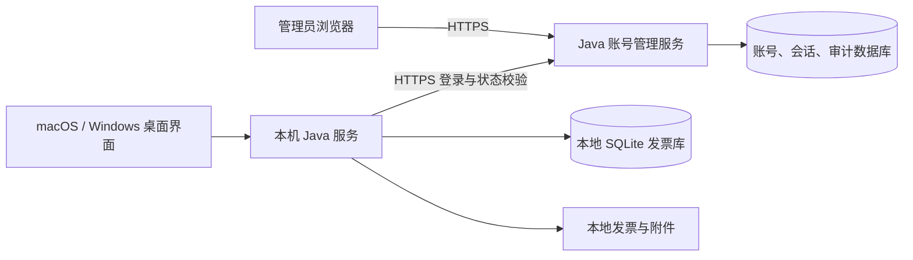

# 票小理账号授权与管理后台 PRD

- 文档版本：1.1
- 所属项目：`ticket-shop-admin`（票小理管理平台），与桌面项目 `ticket-shop` 平级、独立维护
- 日期：2026-11-02
- 状态：技术方案已确认，功能尚未实现；详细实施以开发说明书和阶段流程为准
- 适用产品：票小理 macOS / Windows 官方桌面客户端、独立管理后台
- 范围：管理员开户、联网登录、使用期限、会话校验、冻结与停用、客户端受限状态
- 后端方向：Java；后台前端选型：Vue Pure Admin 官方精简版 + Element Plus
- 实施方式：先在 Mac 本机完成服务端、后台与桌面端联调，再部署独立账号服务

## 1. 背景与目标

票小理已有本地发票整理、发票库、报销及设置能力，当前安装后即可使用。商业交付需要管理用户使用资格，并让管理员能够创建账号、设置使用期限、冻结账号、停用账号及撤销登录会话。

目标：用户通过联网身份验证后使用官方客户端；管理员对账号的变更在明确时间内影响客户端，身份失效不得造成发票丢失或文件操作处于不可恢复的中间状态。

本文是独立项目 `ticket-shop-admin` 的产品需求文档，与桌面项目 `ticket-shop` 的[产品 PRD](../../ticket-shop/docs/PRD.md)配套。与旧文档“不依赖云端服务才能处理发票”的要求冲突时，商业发行版以本文为准：**使用资格依赖联网校验，发票识别与报销处理仍在本机完成。** 其他既有需求不因本次变更自动重写。

## 2. 已确认决策与首版建议

### 2.1 已确认

1. 管理员创建账号并设置使用有效期；首版不开放用户自行注册。
2. 登录时联网检查账号密码、账号状态及使用期限。
3. 登录最长有效时间默认 24 小时，达到期限后必须重新输入密码。
4. 客户端运行时默认每 5 分钟校验一次账号与会话。
5. 网络校验连续不可用时，距上次成功校验最多允许 10 分钟的运行窗口，随后暂停新业务操作。
6. 冻结、停用、改密和管理员重置密码需要撤销相应旧会话。
7. 先本机开发联调，后部署；后端主要使用 Java。
8. 本次先交付 PRD，不编写业务代码，不部署服务，不改变现有用户数据库。

### 2.2 首版默认规则（本轮用户确认沿用）

以下规则作为首版基线，修改时需同步验收条件：

- 客户端保留有效登录凭据，关闭重开后先联网校验；通过则无需再次输密码，但不得突破原 24 小时上限。
- 暂不限制激活设备数量；支持查看、撤销会话。硬件绑定、设备数量套餐及换机审批延期。
- 商业账号只控制本机工作空间的使用权，不引入云端发票租户或多个本地数据空间。
- 受限时允许查看已有发票及创建本地数据备份；禁止新增生产操作，见第 8 节。
- 支持管理员配置客户端会话最长时长；心跳和网络窗口首版固定为 5 / 10 分钟，后台只读展示。
- 管理员后台采用独立且更短的登录策略，见第 9 节；不沿用桌面端 24 小时策略。

## 3. 用户、角色与使用场景

| 角色 | 职责 | 权限边界 |
|---|---|---|
| 超级管理员 | 初始化平台、管理运营管理员、配置会话策略 | 不允许停用或删除最后一个有效超级管理员 |
| 运营管理员 | 创建与维护客户账号、调整期限、冻结、停用、撤销会话 | 无权创建或提升管理员、修改系统策略 |
| 桌面用户 | 使用管理员分配的账号登录票小理 | 无权进入管理后台，无法读取其他账号的会话信息 |

主要场景：

1. 管理员给客户开通一个有期限的账号，客户在 Mac 或 Windows 登录后进入首页。
2. 客户账号到期，客户端暂停新增处理，管理员续期后客户可以重新登录恢复使用。
3. 管理员冻结账号，在线客户端在下次校验时进入受限状态。
4. 用户关闭客户端再打开，在原登录期限内校验通过后直接进入首页。
5. 会话满 24 小时，客户端要求重新登录；原页面、勾选和未完成任务保留。
6. 服务器故障或网络不通，客户端清楚显示连接问题，不误报账号被冻结。

## 4. 范围与非目标

### 4.1 首版必须实现

- 独立账号服务、持久化账号和会话、管理员身份验证。
- 用户创建、查询、编辑基本信息、使用期限调整、冻结/解冻、停用/重新启用。
- 初始密码、首次修改密码、用户改密、管理员重置密码。
- 服务端可撤销会话、客户端心跳、绝对登录期限、主动退出及管理员撤销。
- 管理后台概览、用户管理、会话管理、日志、管理员与策略入口。
- 桌面登录页、账号信息、到期提示、重新验证弹窗及受限状态。
- Java 本地业务层的使用资格门禁，覆盖 UI、Local API、后台入口和系统导入入口。
- macOS / Windows 凭据保存适配、网络恢复、时间及睡眠唤醒处理。
- 审计、限流、错误分类、迁移和端到端验收。

### 4.2 本期不实现

- 自助注册、短信、邮件找回、第三方登录、支付、订阅订单、退款和发票开具。
- 离线许可证、离线激活文件、永久离线使用、硬件加密狗。
- 企业组织架构、部门、审批流、任意自定义角色权限编辑器。
- 云同步、远程访问客户发票、云端 OCR、远程删除本机文件。
- 多个商业账号之间的本地数据隔离、数据合并或自动迁移。
- 对修改版、破解版本提供绝对防绕过保证。

## 5. 管理后台框架调研与选择

### 5.1 调研方法

调研日期为 2026-11-02。比较官方公开文档及代码仓库中的技术栈、后台能力、工程结构与许可信息。以下为针对票小理的适配判断，不是市场占有率排名，也不以 GitHub 星数替代质量评估。

当前桌面前端为 Vue 3 + TypeScript + Vite。`ticket-shop-admin` 独立存放 Java 账号管理服务及后台前端，拥有自己的构建与发布流程，不作为 `ticket-shop` 的 Maven 子模块，不将整套后台模板引入 JavaFX WebView。桌面登录与本地业务门禁仍在 `ticket-shop` 实现。

### 5.2 候选方案

| 方案 | 官方提供的基础 | 针对票小理的判断 | 首版结论 |
|---|---|---|---|
| Ant Design Pro | React、Ant Design、Umi，提供管理系统脚手架 | 企业表格和表单方向适配，但会引入与现有桌面 Vue 不同的应用栈；独立维护两套前端成本较高 | 保留候选，不作为首选 |
| Vben Admin | Vue 3、TypeScript，权限、菜单、主题；支持多组件库，采用 Monorepo 等工程工具 | 能力全面，适合多应用和更大后台；首版规模下不需要其全部工程能力 | 后台规模扩大时可重新评估 |
| Vue Pure Admin 官方精简版 | Vue 3、Vite、TypeScript、Element Plus、Pinia；官方提供精简模板 | 与现有 Vue 认知一致，适合少量高频列表及表单；仍需独立实现服务器鉴权和业务权限 | **本期采用** |

事实依据：[Ant Design 官方 Umi / Pro 说明](https://ant.design/docs/react/use-with-umi/)、[Vben 官方介绍](https://doc.vben.pro/guide/introduction/vben.html)、[Vben 组件库支持](https://doc.vben.pro/guide/in-depth/ui-framework.html)、[Pure Admin 官方仓库](https://github.com/pure-admin/vue-pure-admin)、[官方精简版](https://github.com/pure-admin/pure-admin-thin)。上述维护成本判断是本项目选型推论。

### 5.3 选定组合和使用要求

- 管理后台：Vue Pure Admin 官方精简版，Vue 3 + TypeScript + Vite + Element Plus + Pinia + Vue Router。
- 先使用中文版本，删除模板演示菜单、Mock 登录和不需要的示例功能。
- 保留原项目许可与版权声明；实际引入时复核选中提交及依赖许可。[上游许可证](https://github.com/pure-admin/vue-pure-admin/blob/main/LICENSE)
- 框架仅提供 UI、路由和交互基础，账号、会话、权限判断由 Java 服务端执行。
- 桌面端继续使用现有 Vue 页面和设计系统，只增加登录与账户界面。
- 版本、Node 要求与包管理器在开发说明书中核对、锁定，不直接引用模板的浮动最新版，也不要求升级现有桌面工程。
- 管理后台目标浏览器为发布时当前及上一主要版本 Chrome / Edge；Safari 另做基础验证。Windows 桌面及 JavaFX WebView 兼容性单独验收。

## 6. 产品架构与数据归属



- 新账号管理服务独立于现有随桌面启动的 `app-server`，不能将本机文件处理接口直接部署到公网。
- 服务端建议 Java 21 + Spring Boot + Spring Security，采用模块化单体；数据访问采用MyBatis-Plus＋Flyway，账号数据使用用户现有Docker MySQL 8.0，桌面SQLite不变。
- 首版采用JWT＋Redis 7；会话与撤销事实持久化MySQL，每次认证检查Redis及数据库状态，Redis故障不放行。后台JWT使用HttpOnly Cookie＋CSRF，桌面使用Bearer；JWT不通过自动刷新延长登录上限。不引入微服务、消息队列或外部身份平台。
- 管理后台的业务 API 与桌面认证 API 区分权限范围，普通桌面身份不能调用管理操作。
- 云端保存账号、授权期限、会话、最少设备信息及必要日志；不接收票面、识别文本、发票金额、附件、来源路径或数据库备份。
- 服务重启不重置账号状态、使用期限、撤销记录或会话绝对到期时间。
- 在已有本机工作空间切换商业账号，不自动清空或迁移数据；切换前明确告知本机数据仍属于当前工作空间。系统账户与磁盘权限继续负责本地文件访问隔离。

## 7. 账号状态、使用期限与会话规则

### 7.1 账号状态

| 状态 | 登录及校验行为 | 可恢复方式 |
|---|---|---|
| 有效 ACTIVE | 继续判断使用期限、密码和会话 | 无需恢复 |
| 冻结 FROZEN | 拒绝新登录，撤销全部会话 | 管理员解冻，用户重新登录 |
| 停用 DISABLED | 拒绝新登录，撤销全部会话 | 管理员重新启用，用户重新登录 |

冻结用于临时处理，停用用于结束服务。两者均保留账号、日志和客户本地数据。首版不提供物理删除账号。

“未生效、已到期”是由使用时间计算的授权状态，不增加到账号状态枚举中。有效账号也可能尚未生效或已到期；列表分别显示两种状态。

### 7.2 使用期限

- 创建账号必须填写生效时间 `validFrom` 和到期时间 `validUntil`，且前者严格早于后者；首版不支持无限期账号。
- 时间以服务器 UTC 时刻存储和比较，前端显示时区。按日选择到期日期时，明确显示“有效至当日 23:59:59（所选时区）”，内部转换为下一日零点的排他上界。
- 有效条件为 `validFrom <= serverNow < validUntil`。
- 到期提示在剩余 7 天、3 天、1 天显示非阻塞提醒；到期即暂停新业务，不享受额外网络宽限。
- 延期不自动解冻或启用账号；解冻也不自动延期。操作后界面提示剩余阻碍。
- 缩短期限至当前时间前需要二次确认；相应会话撤销。

### 7.3 登录与运行参数

| 项目 | 首版规则 |
|---|---|
| 客户端登录绝对有效期 | 默认 24 小时；后台可配置 1–24 小时 |
| 状态校验周期 | 应用运行时每 5 分钟；失败后带退避重试，不超过网络窗口 |
| 网络失败窗口 | 自上次成功校验起最多 10 分钟，不因失败重试、页面切换、重启而延长 |
| 启动 / 重开 | 必须先成功联网校验；没有凭据或绝对期限已过则显示登录页 |
| 睡眠唤醒 | 检查期限并立即联网校验，完成前不启动新业务，不补跑多次心跳 |
| 重新输入密码 | 登录会话到期、会话被撤销、密码修改或用户主动退出后 |
| 自动校验 / 凭据轮换 | 不延长本次登录绝对有效期 |
| 实际业务授权上界 | 不晚于账号到期、会话到期、当前校验窗口到期三者的最早时刻 |

绝对会话期限由服务端执行，不依靠网页定时器。参考 [OWASP Session Management](https://cheatsheetseries.owasp.org/cheatsheets/Session_Management_Cheat_Sheet.html)。这里的 24 小时、5 分钟和 10 分钟为本产品约定，不宣称是该指南规定值。

### 7.4 冻结与网络故障的生效边界

- 冻结、停用、改密或主动撤销的成功响应，以服务端状态及撤销记录已提交为准。
- 服务端在每次已认证请求中核验状态、期限和会话撤销情况。
- 正常在线客户端在下一次校验得知冻结状态，目标为 5 分钟加一次请求时限内；请求时限目标 10 秒。操作前重新校验可更早生效，不承诺实时推送。
- 一旦收到明确拒绝，立即进入相应受限状态；不得再套用 10 分钟网络窗口。
- 网络不可达、超时、无效响应或服务器 5xx 属于校验不可用；只有此前已成功认证且当前运行中的客户端可使用剩余窗口。
- 网络窗口满 10 分钟即暂停新业务；仍在重试的请求不能延长授权。
- 服务恢复且原会话仍有效，可校验通过后恢复；会话已过期则需重新登录。
- 修改系统时间不能延长授权。设计需结合服务器授时、运行期单调时间和重启强制联网校验；检测到时钟异常时要求在线确认。

### 7.5 会话持久化与撤销

- 保存可撤销的随机会话凭据，服务端不以客户端提交的账号状态为事实来源。
- 用户账号和管理员会话分离；服务端只保存必要的凭据摘要，不回显完整凭据。
- 桌面凭据由 Java 侧管理，使用系统安全凭据存储；不得存入发票数据库、备份、日志或 WebView localStorage。
- 不支持安全持久化的环境退回进程内凭据，明确提示关闭后需重新登录，不退回明文文件。
- 客户端退出清理凭据，并撤销当前会话；网络不通时先清理本地凭据，提示服务端会话暂未确认撤销，不显示虚假成功。
- 冻结/停用与同时登录的竞态必须有一致结果：冻结提交后不能创建仍可使用的新会话。
- 账号解冻、续期、恢复网络不复活已经撤销的会话；需要重新登录。

## 8. 桌面端需求

### 8.1 登录及首次使用

- 登录页展示票小理 Logo、账号、密码、显示/隐藏密码、登录按钮、联系管理员入口、网络错误反馈。
- 不默认保存密码；可记住账号名。支持密码管理器及粘贴，不记录输入内容。
- 管理员发放临时密码后，首次登录只能完成修改密码流程；成功后才允许进入工作台。
- 初始进入产品前告知：需要联网验证账号；发票及报销数据仍在本机处理。
- 正常登录后进入首页；不会因历史整理任务自动跳离首页。用户进入整理入口时仍遵循现有未入库任务恢复规则。
- 已登录的二次验证返回原页面与工作状态；首次登录或主动切换账号按正常首页入口处理。
- 网络慢时显示明确加载状态，禁止重复提交；失败可重试，不清空账号输入。

### 8.2 账户入口

右上角新增账户入口，与主题、设置并列，避免重排现有核心导航。

展示：账号、显示名、账号状态、使用到期时间、当前登录到期时间、最近成功校验时间、连接状态。

操作：立即验证、修改密码、退出登录、联系管理员；不展示完整令牌、设备硬件编号或内部堆栈。

### 8.3 状态与页面行为

| 客户端状态 | 页面表现 | 允许的动作 |
|---|---|---|
| 未登录 | 登录页；已有本机资料提供受限查看入口 | 登录、查看已有资料、备份、诊断 |
| 启动校验中 | 短暂验证界面，支持重试 | 取消、诊断、受限查看 |
| 已授权 | 正常工作台 | 已有业务功能 |
| 网络暂不可用 | 顶部提示剩余校验窗口 | 有效窗口内继续，窗口结束后转受限 |
| 会话到期或被撤销 | 身份验证弹窗 | 重新登录、受限查看、备份 |
| 账号冻结 | 显示冻结及联系管理员入口 | 重新验证、受限查看、备份 |
| 账号停用 / 使用到期 / 未生效 | 显示对应原因及生效或到期信息 | 重新登录、受限查看、备份 |

已有本机数据的只读查看不代表账号仍可使用生产功能；该设计用于避免商业限制扣留用户资料。操作系统其他用户能否读取这些文件仍由本机权限决定。

### 8.4 业务权限矩阵

| 功能 | 授权有效 | 未登录或受限 |
|---|---|---|
| 查看、查询已有发票和已有报销资料 | 允许 | 允许，只读 |
| 打开已有原件、定位已有文件 | 允许 | 允许，沿用现有系统授权边界 |
| 创建本地数据库备份、打开存储位置、查看诊断 | 允许 | 允许，明确备份不包含票据原件 |
| 新导入、OCR、收件箱扫描、附件索引 | 允许 | 禁止启动 |
| 新建/编辑/删除发票、项目、报销集、事件、材料关联 | 允许 | 禁止 |
| 改名预览、执行改名、重新预检、额度推荐 | 允许 | 禁止启动 |
| 新生成 CSV/XLSX、合并打印、PDF 或 ZIP 报销包 | 允许 | 禁止启动 |
| 访问已经生成且存在的导出物 | 允许 | 允许，不重新生成 |
| 受管操作恢复原名、故障恢复 | 允许 | 允许数据恢复路径，不能借此生成新改名计划 |
| 数据恢复或迁移 | 允许 | 仅允许既有安全恢复/迁移流程，不解除账号限制 |
| 主题、登录网络诊断及安全清理 | 允许 | 允许，保持现有清理边界 |
| Local API | 原有权限加使用资格校验 | 仅允许既有资料的授权只读接口；不得启动生成任务 |

备份、恢复或切换数据目录不能恢复旧账号凭据或将客户端变回已授权状态。

### 8.5 任务与工作进度

- 会话失效不直接退出进程、不清空工作流、不删除选择或已生成的预览。
- 登录失效提示在业务操作被阻止时可见，并保留返回原上下文的能力。
- 批量任务检查“任务启动”和“安全处理边界”：不在单个文件写入、事务提交或补偿中途强制中断。
- 已进入不可分割提交段的步骤完成提交或回滚；后续尚未开始的项暂停。界面展示已完成、暂停和失败数量，不能宣称整批完成。
- 重新登录后由用户选择继续；重新检查来源文件和已有操作结果，不自动重复改名、导入或导出。
- 系统拖入/打开文件在受限状态下不能绕过门禁；已由用户授权的输入可暂存并展示待处理，恢复后人工确认继续。

## 9. 管理后台需求

### 9.1 页面结构

```text
概览
用户管理
  用户列表 → 用户详情（基本资料 / 会话 / 操作记录）
会话管理
操作日志
系统管理（仅超级管理员）
  管理员
  登录策略
```

首版不加入无真实数据的大屏、模板演示图表、菜单编辑器或多余欢迎模块。

### 9.2 概览

- 展示账号总数、有效且在使用期内数量、冻结数量、停用数量、已到期数量、7 天内到期数量。
- 各状态分类需明确统计口径；账号状态和期限状态有重叠时不将卡片简单相加为总数。
- “近期在线”定义为最近 10 分钟成功校验且会话未撤销、未过期，不等于用户当前正在操作。
- 到期列表和异常登录摘要可直接进入对应筛选，不提供虚构营收或活跃率。

### 9.3 用户列表与详情

列表字段：账号、显示名、账号状态、期限状态、生效时间、到期时间、最近登录时间、最近校验时间、有效会话数、创建时间、操作。

- 筛选：账号/显示名关键字、账号状态、期限状态、到期时间范围。
- 排序：到期时间、最近登录时间、创建时间；服务器完成全结果排序。
- 分页：10 / 20 / 50 / 100；首版不提供跨页批量冻结或批量停用。
- 创建账号：账号名、显示名、有效起止时间、临时密码、备注；账号名去除首尾空格并按不区分大小写保证唯一，创建后不可直接改名。
- 编辑不覆盖不可见字段；并发更新冲突提示刷新，不静默覆盖另一管理员操作。
- 用户详情同时展示账号状态与期限状态，解释不能登录的全部已知原因。

### 9.4 管理操作

| 操作 | 必要交互 | 服务端结果 |
|---|---|---|
| 创建用户 | 验证唯一性和期限；临时密码只在提交成功后展示一次 | 账号、强制改密标记和审计记录持久化 |
| 冻结 | 输入原因，确认“撤销现有登录，在线客户端下次校验生效” | 状态冻结，全部会话撤销 |
| 解冻 | 确认，展示是否已经到期 | 恢复账号有效状态，不复活旧会话 |
| 停用 | 输入原因、二次确认，明确不删除本地数据 | 停用并撤销会话 |
| 重新启用 | 确认并展示剩余期限 | 恢复有效状态，不自动延期 |
| 修改期限 | 显示前后时间；缩短需确认 | 更新期限；缩短则撤销旧会话；延期不延长登录期限 |
| 重置密码 | 二次确认，一次性展示新临时密码 | 撤销旧会话，要求下次登录改密 |
| 撤销会话 | 明确当前或全部会话 | 不改变账号状态，旧凭据永久失效 |

临时密码不通过日志、列表、后续详情查询或审计内容再次展示。未送达时重新生成，不找回旧密码。首版由管理员在线下约定渠道交付，不内置消息发送。

### 9.5 会话管理

展示账号、设备显示名、操作系统、客户端版本、登录时间、最近成功校验时间、绝对到期时间、会话状态及撤销原因。

- 状态分为有效、过期、已撤销；近期在线作为独立标记。
- 设备显示名来自客户端声明，仅作识别，不当作可信硬件绑定。
- 支持撤销一条或某账号全部会话；管理员看不到完整凭据。
- 显示“服务器已撤销”和“设备最后校验时间”，不将后台提交成功表述为设备已收到通知。
- 若暂无设备确认回执，不展示“已送达冻结”；会话注销/校验结果可记录最后已知状态。

### 9.6 管理员、登录策略与日志

- 管理员身份独立于桌面用户，支持超级管理员管理运营管理员、停用和重置密码。
- 管理后台建议绝对会话最长 8 小时、空闲 30 分钟后重新登录；后台轮询不算管理员活动。
- 初始化超级管理员使用明确的一次性引导流程，不内置公共默认密码；生产暴露前必须完成初始化并关闭引导入口。
- 登录策略首版允许超级管理员修改桌面会话最长时长 1–24 小时；5 分钟校验和 10 分钟网络窗口只读展示。
- 缩短登录最长时长后，已有会话按原登录时间重新计算较早的上界，最迟下次校验生效；放宽不能延长已有会话，只作用于后续重新登录。
- 审计记录操作者、对象、动作、前后业务值、原因、结果、服务器时间、请求标识；不记录密码或凭据。
- 登录日志记录成功、失败、限流和撤销原因；客户端可识别的登录来源信息受访问权限保护。
- 管理操作与对应审计记录需保证一致，不能出现状态已变更但没有可追溯记录。登录成功、失败及心跳聚合日志分开，避免每 5 分钟生成一条管理操作日志。
- 超级管理员不能删除审计记录。账号修改失败不显示成功，允许重新查询真实状态。

## 10. UI 与交互要求

- 管理后台采用标准企业管理布局：左侧导航、顶部账号区、主体列表、详情抽屉、确认弹窗。
- 使用密度适中的列表与表单，主要筛选保持一行，其他条件按需展开；筛选后显示可清除条件。
- 状态同时使用文字和颜色，不仅靠红绿区分；冻结、停用、到期的说明不能含糊。
- 常规资料在抽屉中编辑，高影响操作单独确认；提交中禁用重复点击，失败保留输入。
- 浅色优先，支持黑色深色；保留票小理现有 Logo 颜色，不将 Logo 转为黑白。
- 管理后台中文界面，统一时间格式、时区说明、表头排序和分页样式。
- 桌面密码到期弹窗避免闪回首页、清空页面或反复叠加多个弹窗；同一时刻只显示一个全局身份状态入口。
- 无权限、无数据、网络失败、提交失败和校验加载均有专门状态，不依赖浏览器控制台解释。

## 11. 数据对象与契约边界

| 对象 | 必要业务信息 |
|---|---|
| 客户账号 | 唯一账号、显示名、密码摘要、账号状态、生效/到期时刻、强制改密、版本号、创建及修改信息 |
| 客户会话 | 账号、凭据摘要、认证时间、绝对到期、最近校验、撤销时间及原因、最小设备信息 |
| 管理员与会话 | 独立身份、角色、状态、密码摘要、会话与撤销信息 |
| 登录策略 | 客户会话最长时长、策略版本、修改人及时间 |
| 审计记录 | 操作者、对象、动作、业务值变化、原因、结果、服务器时间、请求标识 |
| 登录安全记录 | 失败计数、临时限流状态、必要来源信息与结果 |

接口能力至少覆盖：

- 桌面：登录、首次改密、校验当前资格、修改密码、退出、查询账户及策略摘要。
- 管理：管理员登录/退出、用户列表/详情/创建/修改、冻结/解冻/停用/启用、改期、重置密码、会话列表/撤销、日志、管理员及策略。
- 资格响应应明确服务器时刻、账号使用到期、会话绝对到期、下次校验要求和拒绝原因，不能只返回 `true/false`。
- 错误原因区分：凭据错误、账号冻结、停用、未生效、使用到期、会话过期/撤销、首次改密、限流、网络故障、服务故障。
- 未验证密码前，错误提示不泄露账号是否存在、冻结或到期；身份确认后提供可理解的拒绝原因。
- 版本、时钟或协议错误不能被当作验证成功。管理请求采用服务端权限判断和并发版本校验。

具体路径、HTTP 状态、字段、索引及加密算法由后续开发需求说明书确定，不在本 PRD 中把未验证的协议写成既有接口。

## 12. 安全、隐私与运行要求

1. 生产远程接口使用 HTTPS；本机联调可使用限定的本地配置，生产不能携带“跳过认证”开关。
2. 使用成熟密码编码器保存密码摘要，不可逆存储；初始和新密码建议 12–128 字符，允许粘贴和长口令，不静默截断。
3. 登录失败采用账号与来源维度的临时限流；建议同账号 15 分钟内连续失败 5 次后临时限制 15 分钟，成功登录清除失败累计。该限制不写成管理员冻结状态，管理员可查看并解除临时限制。
4. 后台浏览器凭据采用安全会话机制，处理 CSRF、XSS 和权限越界；会话失效由服务器判定，不能只做菜单隐藏。
5. 本机 Java 服务继续验证原有桌面会话和系统访问范围；新增商业校验不替代已有 Local API 授权。
6. 桌面远程凭据不向网页脚本开放；客户端服务地址采用受控配置，不接受票据内容或普通网页输入任意覆盖。
7. 冻结、续期等关键管理更新需要事务、版本冲突处理及不可绕过的服务端检查。
8. 服务端日志不得包含密码、完整令牌、票面、发票内容、客户文件路径或备份正文；登录来源等必要安全元数据需在隐私说明中告知，首版登录安全日志默认保留 90 天，管理审计默认保留 365 天，后续按实际需求审查调整。
9. 服务端账号库建立定期备份和恢复验证。若从旧备份恢复，必须统一撤销恢复前的旧会话，避免已经冻结或撤销的凭据复活；恢复账号状态需核对审计，完成前禁止恢复商业登录。
10. 正式上线前更新 README、客户端首次登录说明及隐私说明，明确云端账号数据与本机票据数据边界。
11. 本方案针对官方发行客户端。全部本地代码公开时，修改版可移除客户端门禁；不将商业授权宣传为不可破解或本地数据库加密。

## 13. 旧版本与发布迁移

- 现有本地发票库、原件、文件名和报销资料不迁移到服务器；升级不可删除或重建本地数据库。
- 升级后首次使用商业版需管理员开通账号，不能静默注册或上传客户资料。
- 现有不含联网校验逻辑的旧安装包不会因后台冻结而自动停止工作；控制范围从接入本方案的官方版本开始，不作追溯承诺。
- 本地备份不包含账号密码和会话；恢复旧台账不改变当前账号状态。
- 新后台、账号服务与桌面版本有协议兼容范围；不支持的版本需明确提示更新，不能假装为账号冻结。
- 发布前明确服务器地址、HTTPS、超级管理员初始化、备份、服务重启和故障恢复步骤；未配置正式服务的测试构建不得对外发售。
- Mac 验证完成不等于 Windows 完成；正式发布必须验证 Windows 安装包、凭据存储、网络异常和登录恢复路径。

## 14. 分阶段交付

| 阶段 | 内容 | 完成门槛 |
|---|---|---|
| A：需求与契约 | 确认本 PRD、开发架构、状态机、权限矩阵、部署参数和接口 | 无关键状态歧义，明确旧版与新商业版边界 |
| B：Java 账号服务 | 账号、管理员引导、登录、密码、期限、会话与撤销、审计 | 不依赖页面也能验证完整登录和冻结闭环 |
| C：管理后台 | 精简模板、真实权限、用户操作、会话、日志和策略 | 页面操作与服务端持久化一致，失败/并发有反馈 |
| D：桌面接入 | 登录、凭据保存、心跳、到期弹窗、受限状态和业务门禁 | UI、Java 服务、Local API 和系统入口无已知绕过 |
| E：完整联调 | Mac 本机联调、网络与时间故障、数据保护、升级回归 | 第 15 节 P0 全通过，不修改真实发票开展破坏性测试 |
| F：部署与双平台验收 | 独立服务 HTTPS、备份恢复、正式后台、Mac / Windows 客户端 | 实机验收、无默认凭据/演示接口，冻结与恢复结果可复核 |

每阶段完成后给出实际证据再进入下一阶段；本文不等同于开始上述实现。

## 15. 可验证验收条件

所有以下用例均为 P0，时间类测试可使用可控测试时钟，正式客户端补做真实计时抽查。真实发票验证沿用项目不超过 10 份的限制，其余使用合成数据。

| 编号 | 操作或条件 | 预期结果 |
|---|---|---|
| AUTH-01 | 管理员创建账号，输入有效凭据 | 首次强制改密，成功后进入首页；不会自动跳到上次整理页 |
| AUTH-02 | 错误账号或密码 | 返回通用凭据错误，不泄露账号状态；失败累计触发限流 |
| AUTH-03 | 冻结、停用、未生效、已到期账号登录 | 分别拒绝；身份验证后给出正确原因 |
| AUTH-04 | 有效登录满 24 小时，期间持续操作和心跳 | 要求重新登录；心跳不能延长绝对期限 |
| AUTH-05 | 关闭重开，原会话未到期且联网正常 | 校验后进入首页，不重复输入密码，不获得新的 24 小时 |
| AUTH-06 | 关闭重开时无网络 | 不凭旧的运行窗口直接进入可生产状态；可受限查看及备份 |
| AUTH-07 | 在线运行时管理员冻结账号 | 服务端立即拒绝旧会话；客户端 5 分钟加请求时限内受限 |
| AUTH-08 | 心跳收到明确冻结拒绝 | 立即受限，不能再等待 10 分钟 |
| AUTH-09 | 运行时断网或服务端 5xx | 显示连接异常；距上次成功校验满 10 分钟后暂停新业务 |
| AUTH-10 | 网络窗口内账号期限或会话期限先到 | 按较早期限受限，不延长到 10 分钟 |
| AUTH-11 | 系统睡眠超过登录期限或将时间回拨 | 唤醒立即验证；未通过前不启动新任务，不延长授权 |
| AUTH-12 | 冻结后解冻、停用后启用或到期后延期 | 条件满足且重新登录后恢复；旧撤销会话不能复活 |
| AUTH-13 | 改密或管理员重置密码 | 所有旧会话失效；重置后需使用临时密码改密 |
| AUTH-14 | 后台缩短会话时长后放宽 | 缩短按原认证时间生效；放宽不延长已有会话 |
| AUTH-15 | 管理员调用被篡改的越权请求 | 服务端拒绝；普通用户不能调用管理 API |
| AUTH-16 | 冻结与登录同时发生、两管理员同时改期 | 无冻结后可用会话；并发冲突不静默覆盖 |
| AUTH-17 | 登录失效时仍有识别、改名或导出任务 | 安全边界暂停/收尾，结果可追踪；重新登录不丢上下文或重复执行 |
| AUTH-18 | 绕过按钮直接调用本地业务 API、Local API、收件箱或系统导入 | 受限生产操作仍被拒绝；允许的只读与恢复接口仍按原权限保护 |
| AUTH-19 | 清缓存、恢复台账或更换数据目录 | 不解除冻结、不恢复旧凭据、不延长会话 |
| AUTH-20 | 服务端重启及从旧备份恢复 | 重启保留撤销结果；旧备份恢复走撤销与账号状态核对流程 |
| AUTH-21 | 检查网络请求、日志、备份及 WebView 存储 | 无票据上传，无密码/完整令牌落入日志、备份或页面持久存储 |
| AUTH-22 | 退出时网络故障 | 本机立即清凭据，提示远程撤销未确认，旧会话仍受期限约束 |
| AUTH-23 | 受限时查看和备份已有数据 | 可访问既有资料和备份；不能编辑或重新生成报销材料 |
| AUTH-24 | Mac 与 Windows 分别安装升级 | 登录、凭据保存、重开、冻结、到期和数据保留均成立 |
| AUTH-25 | 使用未接入认证的旧安装包 | 发布说明明确其不受远程控制；不作虚假的远程禁用验收 |

发布目标：上述用例全部通过；不得以“后台按钮显示成功”替代数据库记录、会话拒绝和桌面行为验证。未验证的 Windows 或生产部署必须明确标记，不计为完成。

## 16. 评审结论与后续文档

本稿采用线上会话控制，替代先前讨论的长期离线许可证方向。用户已确认MyBatis-Plus＋Flyway、JWT＋Redis、本机Docker MySQL 8.0/Redis 7及同仓库前后端分离；暂时无生产服务器。

配套[开发需求说明书](DEVELOPMENT_SPEC.md)与[分阶段开发流程](DEVELOPMENT_PLAN.md)细化：目录与模块、精确版本、建表与注释、接口契约、权限清单、凭据安全存储、会话时钟与任务门禁、Mac 本机环境、部署配置、迁移及测试命令。本期不引入支付或云端票据业务。
